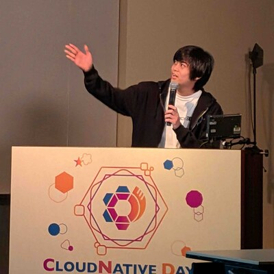

## はじめに

皆さんは Docker を使っていますか？開発環境や Web サービスの運用、クラウド基盤まで、いまやコンテナはあらゆるところで動いています。しかし、「なぜコンテナの中だけ別の Linux マシンのように見えるのか」と聞かれて、すぐに答えられる人は意外と少ないかもしれません。

この講義では、小さなコンテナランタイムを自分の手で作りながら、その答えを探していきます。ただのプロセスを起動するだけから始めて、Linux の持つ「隔離する仕組み」と「制限する仕組み」を一つずつ足していくことで、コンテナらしい実行環境ができあがっていく過程を体験してもらいます。

| 項目 | 内容 |
| --- | --- |
| 日時 | 2026年10月31日（土）10:15〜12:45（150分） |
| 会場 | 長崎県立大学 シーボルト校 |
| 講師 | 川崎晃太朗（筑波大学） |

公式ページ: https://www.security-camp.or.jp/minicamp/nagasaki2026.html

## 自己紹介

- 川崎晃太朗 (X: [@n4mlz](https://x.com/n4mlz) GitHub: [@n4mlz](https://github.com/n4mlz))
- 筑波大学情報学群情報科学類4年
- セキュリティ・キャンプ全国大会2025修了、セキュリティ・キャンプネクスト2026修了。SecHack365 2025では優秀修了生に選出
- CloudNative DaysやJANOGなどのカンファレンスにて登壇経験あり
- Linux コンテナがとにかく好きで、Linuxコンテナをネイティブに実行可能なRust製自作OS「Cyrius」を開発しています。

## 講義の目的

この講義の狙いは、Linux コンテナの仕組みを知ったうえで、コンテナへのイメージの解像度を高めてもらうことです。セキュリティは、そのうちの1つの側面です。次の3つを目指します。

- コンテナが何でできているのかが分かる
- コンテナの特徴 (軽い、速い、持ち運べる) が、なぜそうなのかを、仕組みから説明できる
- 仕組みから、コンテナの向き不向きや危険を判断できる

## 3章構成

講義は、次の3つの章に分かれています。

| 章 | 内容 | 目線 |
| --- | --- | --- |
| 第1章 | コンテナとは何か、なぜ広く使われているのか | 使う側 |
| 第2章 | コンテナの中身はどうなっているのか。ハンズオンで作る | 作る側 |
| 第3章 | 中身を知ったうえで、どう考え、どう使うか | 判断する側 |

## この資料の読み方

この資料は、講義で話す内容も、話さない内容も、全て含んでいます。各ページの冒頭に、講義での扱いを次のように示します。

- 講義で話す: 講義でも扱います。
- 講義で軽く触れる: 講義では一言だけ触れ、詳細は資料で読めます。
- 資料のみ: 読みたい人向けの内容で、講義では扱いません。

ハンズオンの任意の節には、見出しに「(発展)」と付いています。取り組まなくても、次に進めます。資料は、講義の後も公開します。

## 安全上の注意

ハンズオンでは、隔離を弱める操作や、root 権限で行う操作があります。これらは、必ず Dev Container の中だけで実行してください。

## 進め方

演習は Go で行います[^1]。各ステップにはテストを用意し、なるべく自分のペースで進められる形で用意するつもりです。

## 事前学習について

講義は次のことを前提に進める予定です。

- Go で簡単なプログラムが書ける
- Linux のターミナルで基本的な操作ができる
- Docker を使ったことがある
- プロセスとシステムコールについて調べたことがある

これらを揃えるために、[事前学習](../prerequisites/) を用意しています。当日の学びを最大限に高められるよう、講義までに取り組んでおいていただけると嬉しいです。

---

注釈

[^1]: Docker も Go で書かれています
