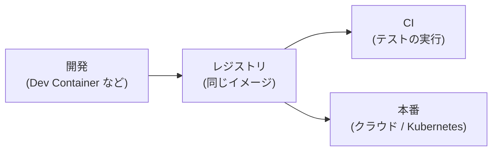

## コンテナの活用例

コンテナは、開発環境としてよく利用されています。必要なツールやライブラリをコンテナの中にまとめておけば、チームの開発者全員が全く同じ環境で開発できるからです。そしてこの講義の演習環境として使っている Dev Container も、その1つと言えます。また、開発で使っているイメージと同じものをそのまま CI[^1] でのテストや本番のサーバで動かす運用も一般的です。

クラウド各社は、イメージを渡すだけでコンテナを動かしてくれるサービス (AWS の ECS や Google Cloud の Cloud Run など) を提供しています。サービスの規模が大きくなり、多数のコンテナを複数のマシンにまたがって管理する必要が出てくると、配置や増減、障害時の再起動、無停止での更新を自動で行う Kubernetes が使われます。AWS の EKS や Google Cloud の GKE のように、Kubernetes の管理を代行するサービスもあります[^2]。

## なぜあえて今、コンテナを学ぶのか

コンテナは登場から十年以上が経つ技術ですが、いま改めて注目されている使い方があります。AI エージェントの実行環境です。

皆さんも、Codex や Claude Code のような AI エージェントを使っているのではないでしょうか。AI エージェントは、利用者の代わりにコマンドを実行したり、コードを書いて動かしたりします。何を実行するのかは、事前には完全に予測できません。そこで、エージェントが動く環境を隔離しておき、想定外の動作をしても影響をその中に閉じ込めたい、という需要が高まって来ています。「サンドボックス内のため権限がなく実行できませんでした」というメッセージが表示されることがありますが、これは実行環境が隔離されている様子をよく表しています。このような隔離にはコンテナや、それに近い仕組みが使われています。

では、コンテナが万能なのか？というと、そうでもありません。2026 年 7 月には、OpenAI が社内で行っていた AI のベンチマークの評価の中で、AI エージェントがコンテナをベースにした隔離環境から外部へ抜け出し、Hugging Face のインフラの一部に侵入した事件が公表されました[^3]。事件の後に OpenAI は、信頼できないコードを動かす環境の隔離を、コンテナ型の隔離から VM 型の隔離へ移行すると説明しています。

エージェントの単純なミスを閉じ込めたいだけなのか、悪意を持って隔離を破ろうとするエージェントまで閉じ込めたいのかによって、隔離に求められる強さは全く異なります。コンテナの隔離がどこまで信頼できるのかについても、近年は改めて議論されています。理由を持ってその問いに答えるには、コンテナの隔離が何によって実現されているのかを、真に知らなければなりません。

---

注釈

[^1]: Continuous Integration (継続的インテグレーション) の略。コードの変更のたびに、テストやビルドを自動で実行する仕組み。

[^2]: そのほかにも、研究用の大規模計算機で実行環境を再現するために使われる例があります。大規模計算機は多くの利用者で共有されるため、他の利用者に影響を与えず環境を再現できるコンテナは相性の良い技術です。ただ、通常の構成の Docker は、管理者権限で動作する常駐プログラムが中心にあり、利用者に使用を許可すると実質的に管理者権限を与えることになるので、Apptainer のような別のツールが使われることも多くあります。

[^3]: OpenAI の発表は、[The Hugging Face incident and the road ahead](https://openai.com/index/hugging-face-incident-and-the-road-ahead/) (2026 年 8 月 26 日) と、[Securing our frontier model training environment](https://openai.com/index/securing-our-frontier-model-training-environment/) (2026 年 10 月 23 日) にあります。事件の全体像は [Wikipedia の記事](https://en.wikipedia.org/wiki/OpenAI%E2%80%93HuggingFace_incident) にもまとまっています。
