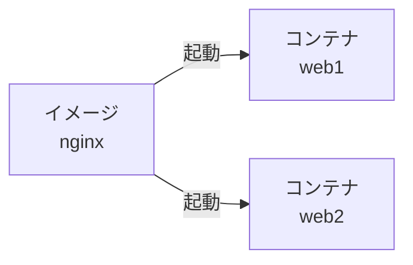
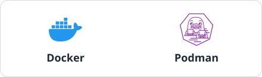

## コンテナとは

アプリケーションを動かすには、アプリケーション本体のほかに、必要なものがいくつも揃っていなければなりません。例えば Python で書かれたアプリケーションなら Python 本体、利用しているライブラリ、設定ファイル、さらに OS が提供するコマンド等が必要です。これらをまとめて、アプリケーションが動く「環境」と呼ぶことがあります。MySQL や Next.js のサーバーを動かしたいときも、それぞれに必要な環境を用意する必要があります。

この「環境」を用意する作業が、いわゆる環境構築です。しかし環境構築というのは面倒なことも多く、手順通りに進めても何故か動作しなかったり、ライブラリのバージョンが少し違うだけでエラーになる、といった経験をした事がある方も多いんじゃないかと思います。

そこで、環境構築を終えた後の完成形をそのままパッケージにして、誰でも展開できるようにしたらどうでしょうか。この「アプリケーションが動作する環境を丸ごとひとまとめにして、持ち運べるようにしたもの」が、コンテナです。

上記では少々語弊のある表現なのですが、いまの段階の理解としてはこれで十分でしょう。詳しくはこれからの章で解説します。

## イメージとコンテナ

前述のような「環境を持ち運べるようにしたパッケージ」をコンテナイメージ[^1]、それを起動して「実際に動いているもの」をコンテナと呼びます。コンテナイメージ=プログラム、コンテナ=プロセスに対応すると考えると分かりやすいと思います。また 1つのプログラムを何回でも同時に実行できるように、1つのイメージから何個でもコンテナを起動することができます。

```sh
docker run -d --name web1 nginx
docker run -d --name web2 nginx
```

上のコマンドは、`nginx` というイメージから、`web1` と `web2` という2つのコンテナを起動します。



2つのコンテナは同じイメージから作られていますが、それぞれ独立した環境として動くことになります。

## Docker

このようなコンテナを扱う代表的なツールが Docker です。コンテナイメージを作成したり、コンテナイメージからコンテナを起動したりすることができます。Docker 以外に、Podman なども良く利用されます[^2]。コンテナを実行するためのソフトウェアは、コンテナランタイムとも呼ばれます。



---

注釈

[^1]: 単にイメージとも呼びます。
[^2]: イメージの形式やコンテナの実行方法には、OCI (Open Container Initiative) という標準の仕様があります。この仕様に従っているため、例えば Docker で作ったイメージを Podman で動かすことができます。
