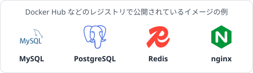
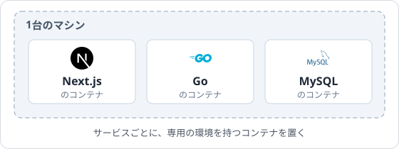

コンテナは、登場してから短い間に、開発の現場で広く使われるようになりました。なぜこれほど多くの人にコンテナが選ばれているのでしょうか？

## 環境構築が不要

MySQL を自分のマシンで動かそうとする場面を考えると。OS に合わせた方法でインストールして、設定ファイルを編集して、ユーザーやデータベースを作って、サービスとして起動して...と作業は意外と多く、手順書のとおりに進めても OS やバージョンの違いで躓くことがあります。ところがコンテナを使えば、以下のコマンド1つで済むことになります。MySQL が動く環境が入ったコンテナイメージを持ってきているからです。

```sh
docker run -d --name mysql -e MYSQL_ROOT_PASSWORD=password -p 3306:3306 mysql:8
```

更には、このようなイメージを公開して、誰でも取得できるようにする場所があります。これが「コンテナレジストリ」と呼ばれる場所です。代表的なものには、Docker Hub や ghcr.io などがあります。嬉しいことに MySQL のような定番のソフトウェアは、公式としてのイメージが公開されています。



自作 Web アプリを作成されている方は、自分の Web アプリをコンテナにして公開したら他の人が `docker run` して直ぐに環境構築済みのものを起動する、ということもできます。

## ポータビリティ

「自分のマシンでは動くのに別のマシンでは動かない」という事例は、開発の現場ではよく起こります。このような場合の原因は大抵、周辺ライブラリのバージョン不整合やパッケージ不足など、環境の違いによるものだと思います。しかしアプリケーションの動く環境含めて1つのイメージにまとめておくと、開発用のマシンでも、本番のサーバでも、適当な誰かのサーバーでも、同じイメージを使って同じ環境で起動することができます。開発に使っているマシンが Windows でも macOS でも Linux でも、コンテナの中の環境を同一にすることができます[^1]。

## 環境が汚れない

普通にマシンへソフトウェアをインストールすると、使わなくなった後も設定ファイルやライブラリがそこら中に残りがちです。コンテナの場合は、コンテナを削除すれば、中で行った変更はホストに影響しません[^2]。試したいものを動かし、不要になれば削除するだけなので、マシンが散らからず、綺麗な状態を保つことができます。

## 起動の速さとメモリ使用量、高密度な実行

コンテナは、起動が速く、使うメモリも少なくて済みます。起動は 1 秒前後で終了し、起動した直後のメモリ使用量も数 MB 程度です (どちらも目安です)。このおかげで、VM なら1つのマシンの上で2つや3つ動かすのが限界なマシンでも、コンテナなら数十サービス同時に動かすことができます。

例えば、Next.js のフロントエンド、Go のバックエンド、MySQL のデータベースから成るシステムを考え、それぞれを専用の環境で動かしたいとします。この場合、コンテナを使ってそれぞれのサービスに必要なものだけが入った環境を、1台のマシンの中に並列に置くことができます。



それぞれのコンテナの中はそのサービス専用の、余計なものが入っていない Linux です。専用のマシンを3台用意したのと同じような環境を、1台のマシンの中で少ない負荷で実現することができます。

...

コンテナは、何故このような特徴を持っているのでしょうか？どうしてこのようなことが可能なのでしょうか？第2章のハンズオンを一通り行うと、コンテナがこのような性質を持つ理由を仕組みから説明できるようになります。

---

注釈

[^1]: イメージは CPU のアーキテクチャに依存します。x86-64 向けに作られたイメージは、そのままでは ARM の CPU を搭載したマシンでは動きません。複数のアーキテクチャに対応して公開されているイメージも多くあります。

[^2]: データベースのデータなど、残しておきたいものは、ボリュームという仕組みでコンテナの外に保存することで情報を永続化しておくことができます。この講義では扱いません。
