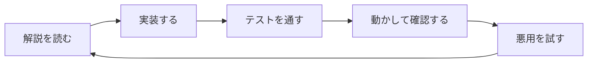

ここからは、実際に手を動かして、小さなコンテナランタイムを作っていきます。作るのは `container run` というコマンドで、最終的には、こんな風にメモリの上限などを指定しながらシェルを起動できるようになります。

```text
$ sudo ./container run -rootfs rootfs -memory 64 sh
```

最初はただのプロセスを起動するだけですが、ステップごとに隔離を1つずつ足していきます。

## 全体の地図

| ステップ | 内容 | 講義 |
| --- | --- | --- |
| 0 | プロセスの起動 | ハンズオン |
| 1 | PID namespace | ハンズオン |
| 2 | mount namespace と rootfs | ハンズオン |
| 3 | cgroup | ハンズオン |
| 4 | user namespace | 講義ではやらない |
| 5 | network namespace | 講義ではやらない |
| 6 | capability と seccomp | 講義ではやらない |

ステップ 4 以降は、講義の時間には取り組みません。続きとして進めたい方向けです。ステップ 1 から 3 の終わりには (発展) と付いた節もありますが、こちらもやらなくて大丈夫で、飛ばしても次のステップに進めます。

## 各ステップの進め方

どのステップも、解説を読んで、実装して、テストを通して、実際に動かして確認する、という流れで進みます。そして最後に、そのステップまでに作ったコンテナを悪用するとしたら何ができるのかを考えて、実際に試してみます。ホストに悪さができてしまうことが分かったら、それが次のステップで塞ぐ穴です。



悪用を試す操作の中には、ホストに影響するものがあります。**必ず Dev Container の中で実行してください。**

各ステップのページは、ゴール、説明、手順、ヒント、テスト、動かして確認、まだ隔離できていないもの、の順で書かれています。余裕のある方向けに、最後に (発展) が付くこともあります。

## ヒントとテスト

ヒントは3つに分かれていて、ヒント 1、ヒント 2、答えの順に詳しくなります。ヒント 1 は文章で、ヒント 2 は変更点を diff の形で (一部は空欄で) 示していて、答えは完成したファイルの全文です。まずは自分で考えてみて、詰まったら開いてください。diff は、`+` の行を足して、`-` の行を消す、という意味です。答えのコードは、そのままファイルにコピーして貼り付ければ動きます。

各ステップにはテストがあって、通れば次に進めます。講義の時間では、ステップ 2 までを目標にしています。遅れてしまった場合は、答えを写して追いついてください。

## コードの構成

リポジトリのルートには、次のファイルがあります。

| ファイル | 内容 |
| --- | --- |
| `main.go` | エントリポイント。`run` と `child` のサブコマンドを振り分ける |
| `options.go` | コマンドラインオプションの解析 |
| `container.go` | コンテナの本体 (`run` と `child`)。ステップごとに書き足す |
| `container_test.go` | 全ステップのテスト |
| `Makefile` | ビルド、rootfs の用意、テストの実行 |
| `scripts/setup-rootfs.sh` | rootfs を作るスクリプト |

ステップを進めると、`rootfs.go`、`cgroup.go`、`network.go`、`security.go` が増えていきます。

利用者が実行するのは `run` ですが、`run` は自分自身を `child` というサブコマンドで起動し直します。この `child` が、隔離された環境の中で準備をして、最後に指定されたコマンドに置き換わります。なぜこんな形にするのかは、ステップ 1 で説明します。
