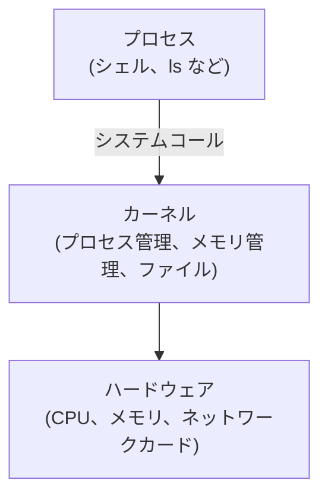
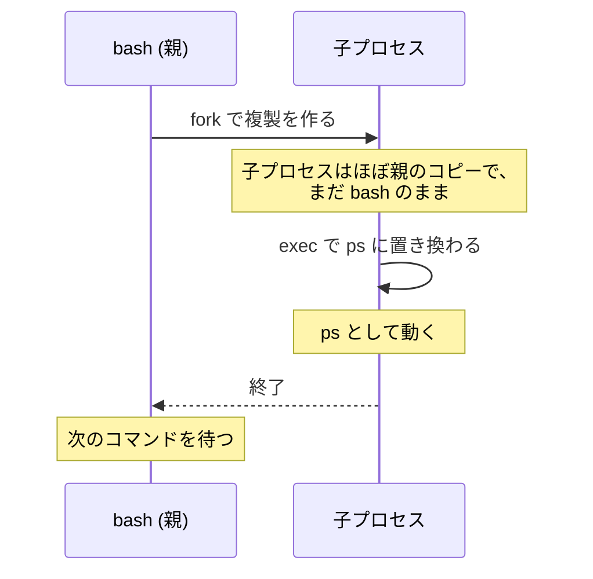

この章では、小さなコンテナランタイムを自分で作っていきます。その前に、事前学習でも出てきたプロセスとシステムコールについて、簡単におさらいしておきます。[事前学習](../../prerequisites/process-and-syscall/)で読んだ方は、読み飛ばしても大丈夫です。

## プロセスとは

プログラムはディスクに置かれた実行ファイルで、プロセスはそのプログラムが実行されている状態のことです。OS はプロセスを1つの単位として管理していて、それぞれに PID (Process ID) という番号を振っています。同じプログラムを2回実行すれば、プロセスは2つできます。

```text
$ ps -o pid,ppid,comm
    PID    PPID COMMAND
      1       0 bash
      7       1 ps
```

`PPID` は、そのプロセスを作った親プロセスの PID です。この例だと、`ps` は PID 1 の `bash` から作られたことが分かります。プロセスは必ず、何かしらの親プロセスから作られます。

## システムコールとは

`ls` を実行するとファイルの一覧が表示されますが、`ls` というプログラム自身がディスクや画面を直接操作しているわけではありません。それらはカーネルにお願いしてやってもらっています。プロセスが好き勝手にディスクやメモリを触れてしまったら、他のプロセスのデータを覗いたり、壊したりできてしまいますよね。そこで、ハードウェアの管理は OS の中核であるカーネルだけが行って、プロセスは「このファイルを開いてください」とカーネルにお願いする決まりになっています。このお願いがシステムコール (syscall) で、`open`、`read`、`write`、`fork` などがあります。



つまり、プロセスに何ができるかは、カーネルが決めていることになります。ということは、**カーネルに「このプロセスができることを減らしてください」とお願いするシステムコールがあれば、プロセスを閉じ込められる**のではないでしょうか。実はこれが、コンテナの正体です。この章では、そのようなシステムコールを1つずつ呼び出しながら、コンテナを組み立てていきます。

## プロセスはどう作られるのか

シェルは、コマンドを実行するたびに新しいプロセスを作っています。このとき使われているのが、`fork` と `exec` です。`fork` は呼び出したプロセスの複製 (子プロセス) を作り、`exec` は今のプロセスの中身を別のプログラムに置き換えます。図にするとこうなります。



もう1つ、`clone` というシステムコールもあります。`fork` と同じように子プロセスを作るのですが、呼び出すときにフラグを渡すことで、親と子で何を共有して、何を分けるのかを選べます。コンテナの隔離には、この仕組みが使われています。

## Go から呼ぶには

Go では、`os/exec` パッケージの `exec.Command` が `fork` と `exec` をやってくれます。`clone` のフラグは、`syscall.SysProcAttr` の `Cloneflags` に渡します。それ以外のシステムコールは、`syscall` パッケージに同じ名前の関数があって (`syscall.Exec` や `syscall.Mount` など)、この章のコードは、ほとんどがこれらの組み合わせでできています。
