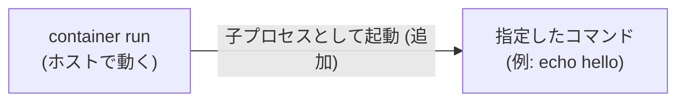

ここから、コンテナランタイムを作り始めます。最初のステップは、ただのプロセスを起動するだけです。

## ゴール

`./container run` に渡したコマンドを子プロセスとして起動して、その終了を待ち、終了コードを返せるようにします。

```text
$ ./container run echo hello
hello
```

## 説明

シェルは、コマンドを実行するときに `fork` と `exec` を使って子プロセスを作っていました。Go では、`os/exec` パッケージの `exec.Command` を使えば、同じことができます。

このステップで足すのは、図の「追加」の部分です。



これから作っていくのは、シェルを起動するためのプログラムです。ステップが進むごとに、起動したシェルの権限を少しずつ絞っていきます。といっても今の時点では、ただ子プロセスを起動しているだけなので、何も権限が絞られていません。どのくらい無防備なのかは、このステップの最後に試してみます。

## 手順

`container.go` の `run` 関数を実装します。コマンドライン引数の解析 (`options.go`) と、プロセスの終了状態を終了コードに変換する `exitCode` 関数 (`main.go`) は、あらかじめ用意してあります。

`opts.cmd` から `exec.Command` でコマンドを作って、標準入出力を自分のものにつなぎ、実行して終了を待ちます。最後に、その結果を `exitCode` に渡して返します。

次の雛形の、コメントで示した場所に実装を書きます。`-` の行は消してください。

```diff title="container.go"
 func run(opts options) (int, error) {
-	// TODO (ステップ 0): opts.cmd を子プロセスとして起動して、終了を待ち、その終了コードを返す。
-	return 1, errors.New("not implemented")
+	// opts.cmd から、exec.Command でコマンドを作る
+	// 標準入出力を、自分の標準入出力につなぐ
+	// 実行して終了を待ち、その結果を exitCode に渡して返す
 }
```

使わなくなった `import` は消して、足りないものは足してください。ビルドのエラーが、何が足りないかを教えてくれます。

実装できたら、`go build -o container .` でビルドが通ることを確認してください。

うまく動かないときは、`run` の最初に `fmt.Fprintln(os.Stderr, "起動します:", opts.cmd)` のような表示を足して、何を起動しようとしているのかを確かめるのも手です (`fmt` を `import` する必要があります)。

<details>
<summary>ヒント 1</summary>

`opts.cmd` の中身はコマンドと引数を並べた文字列のスライスで、1つ目がコマンド名、残りが引数です。

`exec.Command(name, args...)` で作ったコマンドは、`Stdin`、`Stdout`、`Stderr` に `os.Stdin` などを代入すると、自分の入出力につながります。`Run()` で、実行して終了を待てます。

</details>

<details>
<summary>ヒント 2</summary>

実際の差分です。`+` の行を足して、`-` の行を消します。

```diff title="container.go"
--- a/container.go
+++ b/container.go
@@ -2,13 +2,18 @@
 
 import (
 	"errors"
+	"os"
+	"os/exec"
 )
 
 // run は "container run" で実行される。
 // コンテナを起動して、その終了を待ち、コンテナの終了コードを返す。
 func run(opts options) (int, error) {
-	// TODO (ステップ 0): opts.cmd を子プロセスとして起動して、終了を待ち、その終了コードを返す。
-	return 1, errors.New("not implemented")
+	cmd := exec.Command(opts.cmd[0], opts.cmd[1:]...)
+	// 標準入出力は、そのまま引き継ぐ。
+	cmd.Stdin, cmd.Stdout, cmd.Stderr = os.Stdin, os.Stdout, os.Stderr
+
+	return exitCode(cmd.Run())
 }
 
 // child は "container child" で実行される。新しい namespace の中で動く。
```

</details>

<details>
<summary>答え</summary>

```go title="container.go"
package main

import (
	"errors"
	"os"
	"os/exec"
)

// run は "container run" で実行される。
// コンテナを起動して、その終了を待ち、コンテナの終了コードを返す。
func run(opts options) (int, error) {
	cmd := exec.Command(opts.cmd[0], opts.cmd[1:]...)
	// 標準入出力は、そのまま引き継ぐ。
	cmd.Stdin, cmd.Stdout, cmd.Stderr = os.Stdin, os.Stdout, os.Stderr

	return exitCode(cmd.Run())
}

// child は "container child" で実行される。新しい namespace の中で動く。
// コンテナの準備を終えて、最後に、自分を指定されたコマンドに置き換える。
func child(opts options) error {
	// TODO (ステップ 1): コンテナの準備を終えて、opts.cmd を実行する。
	return errors.New("not implemented")
}
```

</details>

## テスト

```text
$ make test STEP=0
go build -o container .
go test -c -o container.test .
sudo ./container.test -test.v -test.count=1 -test.run '^TestStep[0-0]_'
=== RUN   TestStep0_RunsCommand
--- PASS: TestStep0_RunsCommand (0.01s)
=== RUN   TestStep0_ReturnsExitCode
--- PASS: TestStep0_ReturnsExitCode (0.01s)
PASS
```

2つとも `PASS` になれば、このステップは完了です。

## 動かして確認

ビルドして、実際にコマンドを実行してみます。これから先のステップでは root 権限が必要になるので、今から `sudo` を付けておきます。

```text
$ go build -o container .
$ sudo ./container run echo hello
hello
```

起動した子プロセスが、ホストから見えることも確認してみます。ターミナルを2つ開いて、片方で `sleep` を起動します。

```text
$ sudo ./container run sleep 1000
```

もう片方で `ps` を実行すると、`container` と、その子の `sleep` が見つかります。

```text
$ ps -o pid,ppid,comm | grep -E 'container|sleep'
     12       1 container
     19      12 sleep
```

`sleep` の親が `container` になっているので、`container` が作った子プロセスだということが分かります (数字は環境によって変わります)。この `sleep` の PID を指定して `kill` すれば、終了させることもできます。

## うまくいかないとき

`undefined: exec` のようなコンパイルエラーが出たら、`import` に `os/exec` を足し忘れています。

```text
$ go build -o container .
./container.go:11:9: undefined: exec
```

実行したときに、次のようなエラーが出る場合は、起動しようとしているコマンドが見つかっていません。

```text
$ sudo ./container run nosuchcmd
error: exec: "nosuchcmd": executable file not found in $PATH
```

コマンドの綴りを確認してください。綴りが合っているのに出る場合は、`exec.Command` に、コマンド名と引数を分けて渡せているかを確認します。

## まだ隔離できていないもの

このコンテナは、ただの子プロセスなので、ホストとは何も隔離されていません。悪用することを考えると、例えば、ホストで動いている別のプロセスを、コンテナの中から終了させることはできるでしょうか。ホストで `sleep` を動かしておいて、その PID を指定して、コンテナの中から `kill` してみます。

```text
$ sleep 1000 &
[1] 16
$ sudo ./container run kill 16
$
[1]+  Terminated              sleep 1000
```

できてしまいました。PID さえ分かれば、コンテナの中から、ホストのプロセスを好きなように終了できてしまいます。他のプロセスは PID で指定するわけですから、**PID の振り方をコンテナごとに分けてしまえば、この問題は防げそうです。** 次のステップで試してみましょう。
