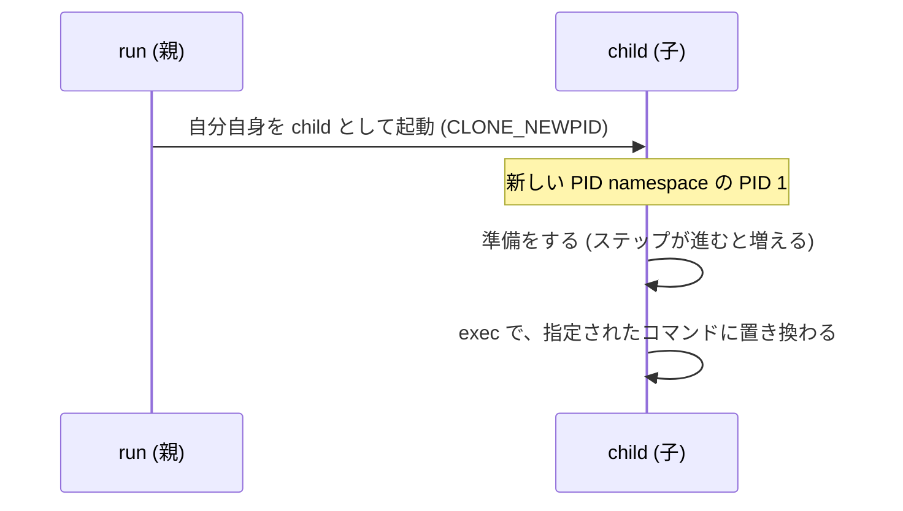

ステップ 0 では、コンテナの中から、ホストのプロセスを `kill` できてしまいました。このステップでは、PID の振り方をコンテナごとに分けて、これを防ぎます。

## ゴール

コンテナの中のプロセスの PID が `1` になって、ホストの他のプロセスは見えなくなるようにします。

```text
$ sudo ./container run sh -c 'echo $$'
1
```

## 説明

コンテナの隔離を支えている仕組みの1つが、namespace です。プロセスから見える世界を分ける仕組みで、PID、ファイルシステム、ネットワークなど、分ける対象ごとに種類があります。このステップで使うのは、PID を分ける PID namespace です。

PID namespace の中では、PID の振り方が外とは独立します。新しく作った namespace の最初のプロセスが PID `1` になって、その中からは、外のプロセスは見えません。ホストの PID 16 のプロセスは、コンテナの中には存在しないことになるので、`kill 16` はできなくなります。

作り方は簡単で、`clone` システムコールにフラグ `CLONE_NEWPID` を渡すだけです。Go では、`exec.Cmd` の `SysProcAttr` の `Cloneflags` に指定します。

```go
cmd.SysProcAttr = &syscall.SysProcAttr{Cloneflags: syscall.CLONE_NEWPID}
```

ただし、これだけでは少し足りません。新しい namespace に入った子プロセスは、そこで隔離のための準備をしてから (準備はステップが進むと増えていきます)、本当に実行したいコマンドに置き換わる必要があります。そこで、親 (`run`) は自分自身 (`/proc/self/exe`) を `child` というサブコマンドで起動して、起動された子 (`child`) が、準備を終えてから `exec` で指定されたコマンドになる、という形にします。



<details>
<summary>なぜ自分自身を再実行するのか</summary>

Go のランタイムは、複数のスレッドを使って動いています。ところが、`fork` で子プロセスにコピーされるのは、呼び出したスレッドだけです。この状態で、Go のコードを続けて実行するのは安全ではありません。C 言語なら、`fork` した後の子プロセスでそのまま準備を続けられるのですが、Go ではそれができないので、`clone` と同時に新しいプログラムを `exec` して、namespace の中で Go のプログラムを最初から起動し直す、という形を取ります。

</details>

## 手順

`container.go` を書き換えます。`run` では、コマンドを直接起動する代わりに、`/proc/self/exe` を `child` サブコマンドで起動して、`Cloneflags` に `CLONE_NEWPID` を指定します。`child` では、`exec.LookPath` でコマンドの場所を探して、`syscall.Exec` で自分をそのコマンドに置き換えます。

<details>
<summary>ヒント 1</summary>

`run` が起動するのは `/proc/self/exe` で、引数は、`os.Args[2:]` の先頭に `"child"` を足したものです。`os.Args[0]` は実行ファイル名、`os.Args[1]` は `run` です。

`child` で `syscall.Exec(path, argv, envv)` を呼ぶと、今のプロセスが、指定したプログラムに置き換わります。`path` はコマンドの場所 (`exec.LookPath` で探せます)、`argv` は `opts.cmd`、`envv` は `os.Environ()` を渡します。

</details>

<details>
<summary>ヒント 2</summary>

```diff title="container.go"
 import (
-	"errors"
 	"os"
 	"os/exec"
+	"syscall"
 )
 
 func run(opts options) (int, error) {
-	cmd := exec.Command(opts.cmd[0], opts.cmd[1:]...)
+	cmd := exec.Command("/proc/self/exe", append([]string{"child"}, os.Args[2:]...)...)
 	cmd.Stdin, cmd.Stdout, cmd.Stderr = os.Stdin, os.Stdout, os.Stderr
+	cmd.SysProcAttr = &syscall.SysProcAttr{Cloneflags: /* PID namespace を作るフラグ */}
 
 	return exitCode(cmd.Run())
 }
 
 func child(opts options) error {
-	// TODO (ステップ 1): コンテナの準備を終えて、opts.cmd を実行する。
-	return errors.New("not implemented")
+	path, err := exec.LookPath(opts.cmd[0])
+	if err != nil {
+		return err
+	}
+	return syscall.Exec( /* コマンドの場所 */ , /* 引数 */ , os.Environ())
 }
```

</details>

<details>
<summary>答え</summary>

```go title="container.go"
package main

import (
	"os"
	"os/exec"
	"syscall"
)

// run は "container run" で実行される。
// コンテナを起動して、その終了を待ち、コンテナの終了コードを返す。
func run(opts options) (int, error) {
	// 自分自身を "child" サブコマンドで再実行して、新しい namespace の中で動かす。
	cmd := exec.Command("/proc/self/exe", append([]string{"child"}, os.Args[2:]...)...)
	// 標準入出力は、そのまま引き継ぐ。
	cmd.Stdin, cmd.Stdout, cmd.Stderr = os.Stdin, os.Stdout, os.Stderr

	// clone のフラグ。作りたい namespace を、ここに足していく。
	// まずは PID namespace。
	flags := uintptr(syscall.CLONE_NEWPID)
	cmd.SysProcAttr = &syscall.SysProcAttr{Cloneflags: flags}

	return exitCode(cmd.Run())
}

// child は "container child" で実行される。新しい namespace の中で動く。
// コンテナの準備を終えて、最後に、自分を指定されたコマンドに置き換える。
func child(opts options) error {
	// コマンドの場所を探して、自分をそのコマンドに置き換える (成功すると戻ってこない)。
	path, err := exec.LookPath(opts.cmd[0])
	if err != nil {
		return err
	}
	return syscall.Exec(path, opts.cmd, os.Environ())
}
```

</details>

## テスト

```text
$ make test STEP=1
go build -o container .
go test -c -o container.test .
sudo ./container.test -test.v -test.count=1 -test.run '^TestStep[0-1]_'
=== RUN   TestStep0_RunsCommand
--- PASS: TestStep0_RunsCommand (0.01s)
=== RUN   TestStep0_ReturnsExitCode
--- PASS: TestStep0_ReturnsExitCode (0.01s)
=== RUN   TestStep1_ProcessIsPID1
--- PASS: TestStep1_ProcessIsPID1 (0.01s)
PASS
```

ステップ 0 のテストも一緒に実行されます。全て `PASS` になれば完了です。

## 動かして確認

コンテナの中のシェルの PID が、`1` になっています。

```text
$ sudo ./container run sh -c 'echo $$'
1
```

ステップ 0 で試した、ホストのプロセスへの `kill` もできなくなりました。ホストの PID 16 は、コンテナの中には存在しないからです。

```text
$ sleep 1000 &
[1] 16
$ sudo ./container run kill 16
kill: (16): No such process
```

## まだ隔離できていないもの

PID は隔離できましたが、ファイルシステムはホストのままです。悪用するなら、ホストのファイルを書き換えたり、消したりするのが手っ取り早そうです。コンテナの中から、ホストの `/tmp` にファイルを作ってみます。

```text
$ sudo ./container run sh -c 'echo hacked > /tmp/hacked'
$ cat /tmp/hacked
hacked
```

コンテナの中で作ったファイルが、ホストにできてしまいました。同じように、`rm` でホストのファイルを消すこともできます。

原因は、コンテナの中から見えるファイルシステムが、ホストのままだということです。コンテナの `/` を、ホストとは別のものに差し替えられれば、防げそうです。次のステップで試します。

## (発展) ホスト名の隔離

やらなくても、次のステップに進めます。

もう1つ、コンテナの中からできてしまう悪さがあります。ホストの名前を勝手に変えることです。

```text
$ hostname
5bd9ee5a4b1a
$ sudo ./container run hostname ultra-vulnerable-machine-2026
$ hostname
ultra-vulnerable-machine-2026
```

ホスト名は、UTS namespace で分けられます。`CLONE_NEWUTS` を `CLONE_NEWPID` に足して、`child` の中で `syscall.Sethostname` を呼べば、コンテナだけのホスト名を持てます。`-hostname` オプションで名前を指定できるようにします (オプションの解析は用意してあります)。

<details>
<summary>答え</summary>

```go title="container.go"
package main

import (
	"fmt"
	"os"
	"os/exec"
	"syscall"
)

// run は "container run" で実行される。
// コンテナを起動して、その終了を待ち、コンテナの終了コードを返す。
func run(opts options) (int, error) {
	// 自分自身を "child" サブコマンドで再実行して、新しい namespace の中で動かす。
	cmd := exec.Command("/proc/self/exe", append([]string{"child"}, os.Args[2:]...)...)
	// 標準入出力は、そのまま引き継ぐ。
	cmd.Stdin, cmd.Stdout, cmd.Stderr = os.Stdin, os.Stdout, os.Stderr

	// clone のフラグ。作りたい namespace を、ここに足していく。
	// まずは PID namespace。
	flags := uintptr(syscall.CLONE_NEWPID)
	// UTS namespace: ホスト名を分ける。
	flags |= syscall.CLONE_NEWUTS
	cmd.SysProcAttr = &syscall.SysProcAttr{Cloneflags: flags}

	return exitCode(cmd.Run())
}

// child は "container child" で実行される。新しい namespace の中で動く。
// コンテナの準備を終えて、最後に、自分を指定されたコマンドに置き換える。
func child(opts options) error {
	// コンテナだけのホスト名を設定する。
	if opts.hostname != "" {
		if err := syscall.Sethostname([]byte(opts.hostname)); err != nil {
			return fmt.Errorf("set hostname: %w", err)
		}
	}

	// コマンドの場所を探して、自分をそのコマンドに置き換える (成功すると戻ってこない)。
	path, err := exec.LookPath(opts.cmd[0])
	if err != nil {
		return err
	}
	return syscall.Exec(path, opts.cmd, os.Environ())
}
```

</details>

```text
$ make test-extra STEP=1
go build -o container .
go test -c -o container.test .
sudo ./container.test -test.v -test.count=1 -test.run '^TestExtra1_'
=== RUN   TestExtra1_Hostname
--- PASS: TestExtra1_Hostname (0.01s)
PASS
```

```text
$ hostname
5bd9ee5a4b1a
$ sudo ./container run -hostname lecture hostname
lecture
$ hostname
5bd9ee5a4b1a
```
