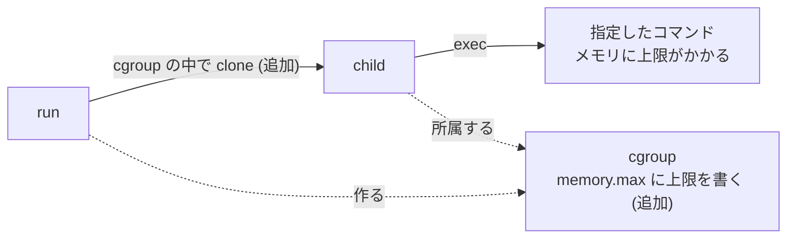

ステップ 2 までで、コンテナから見えるものはかなり絞れました。しかし、ホストのメモリはまだ好きなだけ使えてしまいます。このステップでは、使える資源に上限をかけます。

## ゴール

`-memory` オプションで、コンテナが使えるメモリの上限を指定できるようにします。上限を超えたプロセスは、強制終了されます。

```text
$ sudo ./container run -rootfs rootfs -memory 32 sh -c 'x=aaaaaaaaaaaaaaaa; while true; do x="$x$x"; done'
$ echo $?
137
```

## 説明

ここまでの namespace は、プロセスから見える世界を分けるものでした。それに対して cgroup (control group) は、プロセスが使える資源の量を制限する仕組みで、namespace とは別の種類の隔離です。

このステップで足すのは、図の「追加」の部分です。



cgroup はファイルシステムとして操作します。`/sys/fs/cgroup` の下にディレクトリを作ると、それが1つの cgroup になって、その中に、上限を書き込むためのファイルが自動で現れます。メモリの上限なら `memory.max` です。

```text
$ ls /sys/fs/cgroup/container-42 | grep -E '^(cgroup.procs|cpu.max|memory.max|pids.max)$'
cgroup.procs
cpu.max
memory.max
pids.max
```

プロセスをその cgroup に入れると、そのプロセスと子孫が使う資源が、まとめて制限されます。プロセスの入れ方としては、`cgroup.procs` に PID を書き込む方法もありますが、今回は、`clone` のときに cgroup のディレクトリを指定して、最初からその中でプロセスを起動する方法を使います。Go の `SysProcAttr` の `UseCgroupFD` と `CgroupFD` で指定できます。

## 手順

`cgroup.go` を新しく作って、cgroup のディレクトリを作ったり消したりするコードを書きます。`/sys/fs/cgroup/container-<PID>` というディレクトリを作って、`memory.max` に上限を書き込み、使い終わったら削除します。`-memory` が指定されていなければ、cgroup は作りません。上限は MiB 単位で渡されるので、バイトにするには `1 << 20` を掛けます。

そして `container.go` の `run` で、その cgroup のディレクトリを `SysProcAttr` に指定して、子プロセスが最初から cgroup の中で動くようにします。

次の雛形の、コメントで示した場所に実装を書きます。`-` の行は消してください。

`cgroup.go` は、新しく作るファイルで、骨組みは次のようになります。

```go title="cgroup.go"
package main

type cgroup struct {
	path string
	dir  *os.File
}

func newCgroup(opts options) (*cgroup, error) {
	if opts.memoryMB == 0 {
		return nil, nil
	}
	path := filepath.Join("/sys/fs/cgroup", fmt.Sprintf("container-%d", os.Getpid()))
	// ディレクトリを作る
	// memory.max に上限を書く
	// ディレクトリを開いて、cg.dir に入れる
}

func (cg *cgroup) Close() {
	// ディレクトリを閉じて、削除する
}
```

`container.go` は、次のように変えます。

```diff title="container.go"
 func run(opts options) (int, error) {
+	// cgroup を作る (-memory が無ければ、作られない)
+	// 終わったら、Close で後片付けをする
+
 	cmd := exec.Command("/proc/self/exe", append([]string{"child"}, os.Args[2:]...)...)
 
 	cmd.SysProcAttr = &syscall.SysProcAttr{Cloneflags: flags}
+	// cgroup があれば、子プロセスを最初から cgroup の中で起動するように、SysProcAttr に指定する
```

実装できたら、`go build -o container .` でビルドが通ることを確認してください。

<details>
<summary>ヒント 1</summary>

`os.Mkdir` で cgroup のディレクトリを作って、`memory.max` というファイルに、上限を文字列で書き込みます。`os.OpenFile(path, os.O_WRONLY, 0)` で開いて、`WriteString` します。

ディレクトリを `os.Open` して、その `Fd()` (ファイルディスクリプタ。開いているファイルやディレクトリを指す番号です) を `SysProcAttr.CgroupFD` に渡して、`UseCgroupFD` を `true` にすると、子プロセスが最初から cgroup の中で起動します。

cgroup のディレクトリは、中のプロセスが全て終了してからでないと削除できません。`run` の最後で、`defer` で後片付けをします。

</details>

<details>
<summary>ヒント 2</summary>

実際の差分です。`+` の行を足して、`-` の行を消します。新しく作るファイルは、全文を載せています。

```diff title="container.go"
--- a/container.go
+++ b/container.go
@@ -9,6 +9,15 @@
 // run は "container run" で実行される。
 // コンテナを起動して、その終了を待ち、コンテナの終了コードを返す。
 func run(opts options) (int, error) {
+	// 資源の制限が指定されていれば、cgroup を作る。
+	cg, err := newCgroup(opts)
+	if err != nil {
+		return 1, err
+	}
+	if cg != nil {
+		defer cg.Close()
+	}
+
 	// 自分自身を "child" サブコマンドで再実行して、新しい namespace の中で動かす。
 	cmd := exec.Command("/proc/self/exe", append([]string{"child"}, os.Args[2:]...)...)
 	// 標準入出力は、そのまま引き継ぐ。
@@ -20,6 +29,11 @@
 	// mount namespace: マウントを分ける。
 	flags |= syscall.CLONE_NEWNS
 	cmd.SysProcAttr = &syscall.SysProcAttr{Cloneflags: flags}
+	if cg != nil {
+		// 子プロセスを、最初から cgroup の中で起動する。
+		cmd.SysProcAttr.UseCgroupFD = true
+		cmd.SysProcAttr.CgroupFD = int(cg.dir.Fd())
+	}
 
 	return exitCode(cmd.Run())
 }
```

```go title="cgroup.go"
package main

import (
	"errors"
	"fmt"
	"io/fs"
	"os"
	"path/filepath"
	"strconv"
	"time"
)

const cgroupRoot = "/sys/fs/cgroup"

// cgroup は、コンテナが使える資源を制限する cgroup v2 のディレクトリ。
type cgroup struct {
	path string
	dir  *os.File // 子プロセスを、直接この中で起動できるように、開いたままにしておく
}

// newCgroup は、opts に従って設定した cgroup を作る。
// 制限が何も指定されていなければ、nil を返す。
func newCgroup(opts options) (*cgroup, error) {
	if opts.memoryMB == 0 {
		return nil, nil
	}

	// 上限を書くファイルが現れるように、親の cgroup で controller を有効にしておく。
	// Dev Container ではすでに有効なので、失敗しても構わない (念のための処理)。
	_ = os.WriteFile(filepath.Join(cgroupRoot, "cgroup.subtree_control"), []byte("+memory +pids +cpu"), 0o644)

	// cgroup は、ディレクトリを作るだけで作れる。
	path := filepath.Join(cgroupRoot, fmt.Sprintf("container-%d", os.Getpid()))
	if err := os.Mkdir(path, 0o755); err != nil {
		return nil, fmt.Errorf("create cgroup: %w", err)
	}
	cg := &cgroup{path: path}
	if err := cg.configure(opts); err != nil {
		cg.Close()
		return nil, err
	}
	// 子プロセスを直接 cgroup の中で起動できるように、ディレクトリを開いておく。
	dir, err := os.Open(path)
	if err != nil {
		cg.Close()
		return nil, err
	}
	cg.dir = dir
	return cg, nil
}

func (cg *cgroup) configure(opts options) error {
	if opts.memoryMB > 0 {
		// メモリの上限 (バイト単位)。
		if err := cg.write("memory.max", strconv.Itoa(opts.memoryMB<<20)); err != nil {
			return err
		}
		// スワップに逃げられないようにする。上限を超えると、すぐに OOM killer が動く。
		if err := cg.write("memory.swap.max", "0"); err != nil && !errors.Is(err, fs.ErrNotExist) {
			return err
		}
	}
	return nil
}

// write は、cgroup の制御用ファイルに value を書き込む。
func (cg *cgroup) write(name, value string) error {
	f, err := os.OpenFile(filepath.Join(cg.path, name), os.O_WRONLY, 0)
	if err != nil {
		return err
	}
	defer f.Close()
	if _, err := f.WriteString(value); err != nil {
		return fmt.Errorf("write %s: %w", name, err)
	}
	return nil
}

// Close は、cgroup を削除する。中のプロセスが全て終了するまでは、削除できない。
func (cg *cgroup) Close() {
	if cg.dir != nil {
		cg.dir.Close()
	}
	for i := 0; i < 50; i++ {
		if err := os.Remove(cg.path); err == nil || errors.Is(err, fs.ErrNotExist) {
			return
		}
		time.Sleep(20 * time.Millisecond)
	}
}
```

</details>

<details>
<summary>答え</summary>

```go title="container.go"
package main

import (
	"os"
	"os/exec"
	"syscall"
)

// run は "container run" で実行される。
// コンテナを起動して、その終了を待ち、コンテナの終了コードを返す。
func run(opts options) (int, error) {
	// 資源の制限が指定されていれば、cgroup を作る。
	cg, err := newCgroup(opts)
	if err != nil {
		return 1, err
	}
	if cg != nil {
		defer cg.Close()
	}

	// 自分自身を "child" サブコマンドで再実行して、新しい namespace の中で動かす。
	cmd := exec.Command("/proc/self/exe", append([]string{"child"}, os.Args[2:]...)...)
	// 標準入出力は、そのまま引き継ぐ。
	cmd.Stdin, cmd.Stdout, cmd.Stderr = os.Stdin, os.Stdout, os.Stderr

	// clone のフラグ。作りたい namespace を、ここに足していく。
	// まずは PID namespace。
	flags := uintptr(syscall.CLONE_NEWPID)
	// mount namespace: マウントを分ける。
	flags |= syscall.CLONE_NEWNS
	cmd.SysProcAttr = &syscall.SysProcAttr{Cloneflags: flags}
	if cg != nil {
		// 子プロセスを、最初から cgroup の中で起動する。
		cmd.SysProcAttr.UseCgroupFD = true
		cmd.SysProcAttr.CgroupFD = int(cg.dir.Fd())
	}

	return exitCode(cmd.Run())
}

// child は "container child" で実行される。新しい namespace の中で動く。
// コンテナの準備を終えて、最後に、自分を指定されたコマンドに置き換える。
func child(opts options) error {
	// / を rootfs に差し替える。
	if opts.rootfs != "" {
		if err := setupRootfs(opts.rootfs); err != nil {
			return err
		}
	}

	// コマンドの場所を探して、自分をそのコマンドに置き換える (成功すると戻ってこない)。
	path, err := exec.LookPath(opts.cmd[0])
	if err != nil {
		return err
	}
	return syscall.Exec(path, opts.cmd, os.Environ())
}
```

```go title="cgroup.go"
package main

import (
	"errors"
	"fmt"
	"io/fs"
	"os"
	"path/filepath"
	"strconv"
	"time"
)

const cgroupRoot = "/sys/fs/cgroup"

// cgroup は、コンテナが使える資源を制限する cgroup v2 のディレクトリ。
type cgroup struct {
	path string
	dir  *os.File // 子プロセスを、直接この中で起動できるように、開いたままにしておく
}

// newCgroup は、opts に従って設定した cgroup を作る。
// 制限が何も指定されていなければ、nil を返す。
func newCgroup(opts options) (*cgroup, error) {
	if opts.memoryMB == 0 {
		return nil, nil
	}

	// 上限を書くファイルが現れるように、親の cgroup で controller を有効にしておく。
	// Dev Container ではすでに有効なので、失敗しても構わない (念のための処理)。
	_ = os.WriteFile(filepath.Join(cgroupRoot, "cgroup.subtree_control"), []byte("+memory +pids +cpu"), 0o644)

	// cgroup は、ディレクトリを作るだけで作れる。
	path := filepath.Join(cgroupRoot, fmt.Sprintf("container-%d", os.Getpid()))
	if err := os.Mkdir(path, 0o755); err != nil {
		return nil, fmt.Errorf("create cgroup: %w", err)
	}
	cg := &cgroup{path: path}
	if err := cg.configure(opts); err != nil {
		cg.Close()
		return nil, err
	}
	// 子プロセスを直接 cgroup の中で起動できるように、ディレクトリを開いておく。
	dir, err := os.Open(path)
	if err != nil {
		cg.Close()
		return nil, err
	}
	cg.dir = dir
	return cg, nil
}

func (cg *cgroup) configure(opts options) error {
	if opts.memoryMB > 0 {
		// メモリの上限 (バイト単位)。
		if err := cg.write("memory.max", strconv.Itoa(opts.memoryMB<<20)); err != nil {
			return err
		}
		// スワップに逃げられないようにする。上限を超えると、すぐに OOM killer が動く。
		if err := cg.write("memory.swap.max", "0"); err != nil && !errors.Is(err, fs.ErrNotExist) {
			return err
		}
	}
	return nil
}

// write は、cgroup の制御用ファイルに value を書き込む。
func (cg *cgroup) write(name, value string) error {
	f, err := os.OpenFile(filepath.Join(cg.path, name), os.O_WRONLY, 0)
	if err != nil {
		return err
	}
	defer f.Close()
	if _, err := f.WriteString(value); err != nil {
		return fmt.Errorf("write %s: %w", name, err)
	}
	return nil
}

// Close は、cgroup を削除する。中のプロセスが全て終了するまでは、削除できない。
func (cg *cgroup) Close() {
	if cg.dir != nil {
		cg.dir.Close()
	}
	for i := 0; i < 50; i++ {
		if err := os.Remove(cg.path); err == nil || errors.Is(err, fs.ErrNotExist) {
			return
		}
		time.Sleep(20 * time.Millisecond)
	}
}
```

</details>

答えのコードには、2つ補足があります。

- cgroup v2 では、子の cgroup でメモリを制限するために、親の `cgroup.subtree_control` で `memory` が有効になっている必要があります。Dev Container ではすでに有効になっているので、`newCgroup` の最初の1行はお守りのようなものです。
- `memory.swap.max` に `0` を書いているのは、スワップを使わせないためです。スワップに逃げられてしまうと、上限を超えてもプロセスが止まらないことがあります。

## テスト

```text
$ make test STEP=3
go build -o container .
go test -c -o container.test .
sudo ./container.test -test.v -test.count=1 -test.run '^TestStep[0-3]_'
=== RUN   TestStep0_RunsCommand
--- PASS: TestStep0_RunsCommand (0.01s)
=== RUN   TestStep0_ReturnsExitCode
--- PASS: TestStep0_ReturnsExitCode (0.01s)
=== RUN   TestStep1_ProcessIsPID1
--- PASS: TestStep1_ProcessIsPID1 (0.01s)
=== RUN   TestStep2_RootfsIsAlpine
--- PASS: TestStep2_RootfsIsAlpine (0.01s)
=== RUN   TestStep3_MemoryLimitKillsProcess
--- PASS: TestStep3_MemoryLimitKillsProcess (0.09s)
=== RUN   TestStep3_ProcessUnderLimitSucceeds
--- PASS: TestStep3_ProcessUnderLimitSucceeds (0.01s)
=== RUN   TestStep3_CgroupIsRemoved
--- PASS: TestStep3_CgroupIsRemoved (0.01s)
PASS
```

## 動かして確認

上限の範囲で動くコマンドは、普通に動きます。

```text
$ sudo ./container run -rootfs rootfs -memory 64 echo ok
ok
```

上限を超えてメモリを使い続けるコマンドは、強制終了されます[^2]。終了コードの `137` は `128 + 9` で、`SIGKILL` で終了させられたことを表します。

```text
$ sudo ./container run -rootfs rootfs -memory 32 sh -c 'x=aaaaaaaaaaaaaaaa; while true; do x="$x$x"; done'
$ echo $?
137
```

コンテナが動いている間に、別のターミナルから cgroup のファイルを覗いてみます。

```text
$ sudo ./container run -rootfs rootfs -memory 64 sleep 30 &
$ cat /sys/fs/cgroup/container-*/memory.max
67108864
```

終了すれば、cgroup のディレクトリは削除されます。

## うまくいかないとき

`sudo` を付け忘れると、cgroup のディレクトリを作れません。

```text
$ ./container run -rootfs rootfs -memory 32 echo hi
error: create cgroup: mkdir /sys/fs/cgroup/container-11: permission denied
```

`memory.max` に関するエラーが出る場合は、[トラブルシューティング](../troubleshooting/)を見てください。

## まだ隔離できていないもの

資源は制限できました。しかし、他の面はどうでしょうか。コンテナの中で、色々と試してみます。

```text
$ sudo ./container run -rootfs rootfs sh -c 'id; touch /tmp/owner-test'
uid=0(root) gid=0(root) groups=0(root)
$ ls -ln rootfs/tmp/owner-test
-rw-r--r-- 1 0 0 0 Oct 30 16:10 rootfs/tmp/owner-test
```

コンテナの中の `root` は、ホストの `root` と同じ存在で、作ったファイルもホストの `root` のものになっています。他にも、ホストのネットワークインターフェースがそのまま見えていて、`mount` のような強力な操作もできてしまいます。

```text
$ sudo ./container run -rootfs rootfs sh -c 'mount -t tmpfs tmpfs /mnt && echo mounted'
mounted
```

権限とネットワークも隔離したいところですが、これらはステップ 4 から 6 で扱います。講義の時間にはやらないので、続きとして取り組んでみてください。

## (発展) プロセス数と CPU の制限

やらなくても、次のステップに進めます。

cgroup では、メモリ以外も制限できます。`pids.max` は、コンテナの中で作れるプロセス (スレッド) の数の上限で、フォークボムのようなものを止められます。`cpu.max` は、使える CPU の時間で、`<上限> <周期>` の形式でマイクロ秒単位で書きます。`100000 100000` なら1コア分、`50000 100000` なら半分です。

`-pids` と `-cpus` のオプションで指定できるようにします。`-pids` には、Go のランタイム自身が使うスレッドの分もあるので、`20` くらいを指定してください。

<details>
<summary>答え</summary>

```go title="cgroup.go"
package main

import (
	"errors"
	"fmt"
	"io/fs"
	"os"
	"path/filepath"
	"strconv"
	"time"
)

const cgroupRoot = "/sys/fs/cgroup"

// cgroup は、コンテナが使える資源を制限する cgroup v2 のディレクトリ。
type cgroup struct {
	path string
	dir  *os.File // 子プロセスを、直接この中で起動できるように、開いたままにしておく
}

// newCgroup は、opts に従って設定した cgroup を作る。
// 制限が何も指定されていなければ、nil を返す。
func newCgroup(opts options) (*cgroup, error) {
	if opts.memoryMB == 0 && opts.pids == 0 && opts.cpus == 0 {
		return nil, nil
	}

	// 上限を書くファイルが現れるように、親の cgroup で controller を有効にしておく。
	// Dev Container ではすでに有効なので、失敗しても構わない (念のための処理)。
	_ = os.WriteFile(filepath.Join(cgroupRoot, "cgroup.subtree_control"), []byte("+memory +pids +cpu"), 0o644)

	// cgroup は、ディレクトリを作るだけで作れる。
	path := filepath.Join(cgroupRoot, fmt.Sprintf("container-%d", os.Getpid()))
	if err := os.Mkdir(path, 0o755); err != nil {
		return nil, fmt.Errorf("create cgroup: %w", err)
	}
	cg := &cgroup{path: path}
	if err := cg.configure(opts); err != nil {
		cg.Close()
		return nil, err
	}
	// 子プロセスを直接 cgroup の中で起動できるように、ディレクトリを開いておく。
	dir, err := os.Open(path)
	if err != nil {
		cg.Close()
		return nil, err
	}
	cg.dir = dir
	return cg, nil
}

func (cg *cgroup) configure(opts options) error {
	if opts.memoryMB > 0 {
		// メモリの上限 (バイト単位)。
		if err := cg.write("memory.max", strconv.Itoa(opts.memoryMB<<20)); err != nil {
			return err
		}
		// スワップに逃げられないようにする。上限を超えると、すぐに OOM killer が動く。
		if err := cg.write("memory.swap.max", "0"); err != nil && !errors.Is(err, fs.ErrNotExist) {
			return err
		}
	}
	if opts.pids > 0 {
		// プロセス (スレッド) の数の上限。
		if err := cg.write("pids.max", strconv.Itoa(opts.pids)); err != nil {
			return err
		}
	}
	if opts.cpus > 0 {
		// cpu.max は "<上限> <周期>" の形式で、単位はマイクロ秒。
		const period = 100000
		quota := int(opts.cpus * period)
		if err := cg.write("cpu.max", fmt.Sprintf("%d %d", quota, period)); err != nil {
			return err
		}
	}
	return nil
}

// write は、cgroup の制御用ファイルに value を書き込む。
func (cg *cgroup) write(name, value string) error {
	f, err := os.OpenFile(filepath.Join(cg.path, name), os.O_WRONLY, 0)
	if err != nil {
		return err
	}
	defer f.Close()
	if _, err := f.WriteString(value); err != nil {
		return fmt.Errorf("write %s: %w", name, err)
	}
	return nil
}

// Close は、cgroup を削除する。中のプロセスが全て終了するまでは、削除できない。
func (cg *cgroup) Close() {
	if cg.dir != nil {
		cg.dir.Close()
	}
	for i := 0; i < 50; i++ {
		if err := os.Remove(cg.path); err == nil || errors.Is(err, fs.ErrNotExist) {
			return
		}
		time.Sleep(20 * time.Millisecond)
	}
}
```

</details>

```text
$ make test-extra STEP=3
go build -o container .
go test -c -o container.test .
sudo ./container.test -test.v -test.count=1 -test.run '^TestExtra3_'
=== RUN   TestExtra3_PidsLimit
--- PASS: TestExtra3_PidsLimit (0.01s)
=== RUN   TestExtra3_CpuLimit
--- PASS: TestExtra3_CpuLimit (0.10s)
PASS
```

```text
$ sudo ./container run -rootfs rootfs -pids 20 sh -c 'for i in $(seq 30); do sleep 1 & done; wait'
sh: can't fork: Resource temporarily unavailable
```

[^2]: メモリが足りなくなったときに、カーネルがプロセスを強制終了して、メモリを空ける仕組みを OOM (Out Of Memory) killer と呼びます。cgroup の上限を超えたときにも、この仕組みが働きます。
