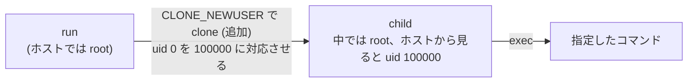

このステップは、講義の時間にはやらず、続きとして取り組んでもらうためのものです。

ステップ 3 の最後に見たように、コンテナの中の `root` は、ホストの `root` と同じ存在でした。このステップでは、これを分けます。

## ゴール

コンテナの中では `root` なのに、ホストから見ると権限のない一般ユーザーになるようにします。

```text
$ sudo ./container run -rootfs rootfs -userns sh -c 'id; touch /tmp/owner-test'
uid=0(root) gid=0(root) groups=65534(nobody)
$ ls -ln rootfs/tmp/owner-test
-rw-r--r-- 1 100000 100000 0 Oct 30 16:10 rootfs/tmp/owner-test
```

コンテナの中では `root` (uid 0) ですが、ホストから見ると、そのファイルの持ち主は uid 100000 です。

## 説明

root のままだと、何が困るのでしょうか。例えば、コンテナの隔離を何らかの方法で破って、外に出られてしまったとします。そのとき、コンテナの中の root がホストの root そのものだったら、ホストを好きなようにされてしまいます。逆に、ホストでは権限のない一般ユーザーなら、被害を小さく抑えられます。

このステップで足すのは、図の「追加」の部分です。



これを実現するのが、user namespace です。ユーザー ID (uid) とグループ ID (gid) の対応表 (マッピング) を、namespace ごとに持てます。例えば、「コンテナの中の uid 0 から 65536 個を、ホストの uid 100000 から 65536 個に対応させる」と決めると、コンテナの中の `root` は、ホストでは uid 100000 になります。

```text
コンテナの中      ホスト
0 (root)     →   100000
1            →   100001
...
65535        →   165535
```

Go では、`SysProcAttr` の `UidMappings` と `GidMappings` に、この対応表を渡します。それから、user namespace の中で `root` として振る舞うために、`Credential` で uid 0 も指定します。これがないと、コンテナの中のプロセスが `nobody` として起動してしまって、権限を持てません。

## 手順

`container.go` の `run` で、`-userns` が指定されたときの設定を足します。`Cloneflags` に `CLONE_NEWUSER` を足して、`UidMappings` と `GidMappings` に `{ContainerID: 0, HostID: 100000, Size: 65536}` を、`Credential` に `Uid: 0, Gid: 0, NoSetGroups: true` を指定します。

次の雛形の、コメントで示した場所に実装を書きます。`-` の行は消してください。

```diff title="container.go"
 	cmd.SysProcAttr = &syscall.SysProcAttr{Cloneflags: flags}
+	// -userns のときは、次の設定を足す
+	//   - Cloneflags に、user namespace を作るフラグを足す
+	//   - UidMappings と GidMappings に、{ContainerID: 0, HostID: 100000, Size: 65536} を指定する
+	//   - Credential に、Uid: 0, Gid: 0, NoSetGroups: true を指定する
```

実装できたら、`go build -o container .` でビルドが通ることを確認してください。

<details>
<summary>ヒント 1</summary>

`UidMappings` と `GidMappings` は、`[]syscall.SysProcIDMap` です。`SysProcIDMap` には、`ContainerID`、`HostID`、`Size` があります。

</details>

<details>
<summary>ヒント 2</summary>

実際の差分です。`+` の行を足して、`-` の行を消します。

```diff title="container.go"
--- a/container.go
+++ b/container.go
@@ -34,6 +34,15 @@
 		cmd.SysProcAttr.UseCgroupFD = true
 		cmd.SysProcAttr.CgroupFD = int(cg.dir.Fd())
 	}
+	if opts.userns {
+		// コンテナの中の root を、ホストでは権限のない ID の範囲に対応させる。
+		cmd.SysProcAttr.Cloneflags |= syscall.CLONE_NEWUSER
+		idMap := []syscall.SysProcIDMap{{ContainerID: 0, HostID: 100000, Size: 65536}}
+		cmd.SysProcAttr.UidMappings = idMap
+		cmd.SysProcAttr.GidMappings = idMap
+		// user namespace の中で root になる。これがないと、子プロセスは権限を持てない。
+		cmd.SysProcAttr.Credential = &syscall.Credential{Uid: 0, Gid: 0, NoSetGroups: true}
+	}
 
 	return exitCode(cmd.Run())
 }
```

</details>

<details>
<summary>答え</summary>

```go title="container.go"
package main

import (
	"os"
	"os/exec"
	"syscall"
)

// run は "container run" で実行される。
// コンテナを起動して、その終了を待ち、コンテナの終了コードを返す。
func run(opts options) (int, error) {
	// 資源の制限が指定されていれば、cgroup を作る。
	cg, err := newCgroup(opts)
	if err != nil {
		return 1, err
	}
	if cg != nil {
		defer cg.Close()
	}

	// 自分自身を "child" サブコマンドで再実行して、新しい namespace の中で動かす。
	cmd := exec.Command("/proc/self/exe", append([]string{"child"}, os.Args[2:]...)...)
	// 標準入出力は、そのまま引き継ぐ。
	cmd.Stdin, cmd.Stdout, cmd.Stderr = os.Stdin, os.Stdout, os.Stderr

	// clone のフラグ。作りたい namespace を、ここに足していく。
	// まずは PID namespace。
	flags := uintptr(syscall.CLONE_NEWPID)
	// mount namespace: マウントを分ける。
	flags |= syscall.CLONE_NEWNS
	cmd.SysProcAttr = &syscall.SysProcAttr{Cloneflags: flags}
	if cg != nil {
		// 子プロセスを、最初から cgroup の中で起動する。
		cmd.SysProcAttr.UseCgroupFD = true
		cmd.SysProcAttr.CgroupFD = int(cg.dir.Fd())
	}
	if opts.userns {
		// コンテナの中の root を、ホストでは権限のない ID の範囲に対応させる。
		cmd.SysProcAttr.Cloneflags |= syscall.CLONE_NEWUSER
		idMap := []syscall.SysProcIDMap{{ContainerID: 0, HostID: 100000, Size: 65536}}
		cmd.SysProcAttr.UidMappings = idMap
		cmd.SysProcAttr.GidMappings = idMap
		// user namespace の中で root になる。これがないと、子プロセスは権限を持てない。
		cmd.SysProcAttr.Credential = &syscall.Credential{Uid: 0, Gid: 0, NoSetGroups: true}
	}

	return exitCode(cmd.Run())
}

// child は "container child" で実行される。新しい namespace の中で動く。
// コンテナの準備を終えて、最後に、自分を指定されたコマンドに置き換える。
func child(opts options) error {
	// / を rootfs に差し替える。
	if opts.rootfs != "" {
		if err := setupRootfs(opts.rootfs); err != nil {
			return err
		}
	}

	// コマンドの場所を探して、自分をそのコマンドに置き換える (成功すると戻ってこない)。
	path, err := exec.LookPath(opts.cmd[0])
	if err != nil {
		return err
	}
	return syscall.Exec(path, opts.cmd, os.Environ())
}
```

</details>

## テスト

```text
$ make test STEP=4
go build -o container .
go test -c -o container.test .
sudo ./container.test -test.v -test.count=1 -test.run '^TestStep[0-4]_'
=== RUN   TestStep0_RunsCommand
--- PASS: TestStep0_RunsCommand (0.01s)
=== RUN   TestStep0_ReturnsExitCode
--- PASS: TestStep0_ReturnsExitCode (0.01s)
=== RUN   TestStep1_ProcessIsPID1
--- PASS: TestStep1_ProcessIsPID1 (0.01s)
=== RUN   TestStep2_RootfsIsAlpine
--- PASS: TestStep2_RootfsIsAlpine (0.01s)
=== RUN   TestStep3_MemoryLimitKillsProcess
--- PASS: TestStep3_MemoryLimitKillsProcess (0.12s)
=== RUN   TestStep3_ProcessUnderLimitSucceeds
--- PASS: TestStep3_ProcessUnderLimitSucceeds (0.00s)
=== RUN   TestStep3_CgroupIsRemoved
--- PASS: TestStep3_CgroupIsRemoved (0.01s)
=== RUN   TestStep4_RootIsMappedToUnprivilegedID
--- PASS: TestStep4_RootIsMappedToUnprivilegedID (0.01s)
=== RUN   TestStep4_FilesAreOwnedByMappedID
--- PASS: TestStep4_FilesAreOwnedByMappedID (0.01s)
PASS
```

## 動かして確認

コンテナの中で、対応表を見てみます。

```text
$ sudo ./container run -userns cat /proc/self/uid_map
         0     100000      65536
```

`root` のはずなのに、ホストの `root` が持っているファイルは書き換えられなくなりました。

```text
$ sudo ./container run -rootfs rootfs -userns sh -c 'ls -ln /etc/os-release; echo x > /etc/os-release'
-rw-r--r--    1 65534    65534          189 Apr 15  2026 /etc/os-release
sh: can't create /etc/os-release: Permission denied
```

`/etc/os-release` の持ち主は、ホストでは `root` (uid 0) ですが、その uid は対応表に載っていないので、コンテナの中では `nobody` (65534) に見えます。コンテナの中の `root` には、これを書き換える権限がありません。

## うまくいかないとき

`Credential` を指定し忘れると、コンテナの中で権限がなくなってしまい、`chroot` に失敗します。

```text
$ sudo ./container run -rootfs rootfs -userns echo hi
error: chroot: operation not permitted
```

## まだ隔離できていないもの

user namespace でユーザーは分けられましたが、ネットワークはまだホストと共有しています。コンテナの中からホストのネットワークインターフェースが見えますし、ホストが待ち受けているポートにも、つなげてしまいます。

ネットワークも分けてしまえば、この点も防げそうです。これは次のステップで扱います。
