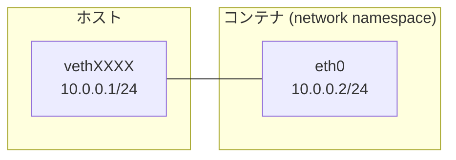
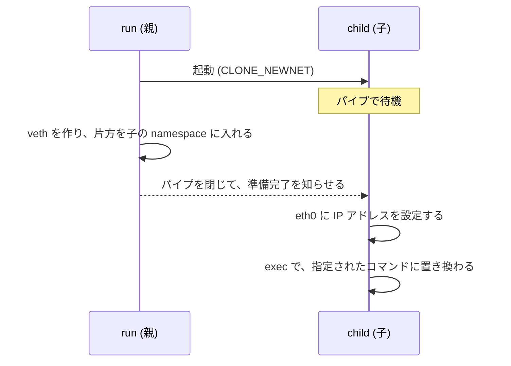

ステップ 4 と同じく、講義の時間にはやらないステップです。

ここまでのコンテナは、ホストのネットワークインターフェースをそのまま共有しています。このステップでは、ネットワークを分けます。

## ゴール

`-net` を付けると、コンテナがホストとは別の、自分専用のネットワークを持つようにします。ホストとは仮想的なケーブルでつながって、お互いに通信できます。

```text
$ sudo ./container run -rootfs rootfs -net ping -c 2 10.0.0.1
PING 10.0.0.1 (10.0.0.1): 56 data bytes
64 bytes from 10.0.0.1: seq=0 ttl=64 time=0.094 ms
64 bytes from 10.0.0.1: seq=1 ttl=64 time=0.114 ms

--- 10.0.0.1 ping statistics ---
2 packets transmitted, 2 packets received, 0% packet loss
round-trip min/avg/max = 0.094/0.104/0.114 ms
```

## 説明

network namespace を作ると、その中は、ネットワークインターフェースも IP アドレスもルーティング表も、全て空の状態から始まります。作った直後は、ループバック (`lo`) があるだけで、外とは通信できません。

外とつなぐために、veth (virtual ethernet) という仮想的なケーブルを使います。veth は必ず2つ組で作られて、片方に入った通信がもう片方から出てきます。この片方をコンテナの network namespace に入れて、もう片方をホストに残します。



network namespace は、ネットワークの側から見ると、それだけで独立した1台のホストに見えます。つまりこれは、Linux の中だけで、2台のホストを仮想的につないでいることになります。

1つ難しい点があって、veth をコンテナの namespace に入れる作業は、子のプロセスが起動した後に、親がやる必要があります。一方で、子は、その作業が終わってから自分のネットワークを設定しなければなりません。そこで、親と子の間にパイプを1本通して、親の準備が終わるまで子が待つようにします。



## 手順

実装は、`ip` コマンドを呼び出す形で行います。

`network.go` を新しく作って、親が呼ぶ `setupHostNetwork(pid)` と、子が呼ぶ `setupContainerNetwork()` を書きます。前者は、veth の組を作って、片方 (名前は `eth0`) を `pid` の network namespace に入れて、もう片方に `10.0.0.1/24` を設定します。後者は、`lo` と `eth0` を有効にして、`eth0` に `10.0.0.2/24` を設定します。

`container.go` の `run` では、`-net` のときに `CLONE_NEWNET` を足して、パイプを作って子に渡します。子を起動した後に `setupHostNetwork` を呼んで、それからパイプを閉じます。`child` では、パイプが閉じるのを待ってから、`-net` のときに `setupContainerNetwork` を呼びます。

<details>
<summary>ヒント 1</summary>

`ip link add vethXXXX type veth peer name eth0 netns <PID>` というコマンドで、veth の組を作って、片方を指定した PID の namespace に、同時に入れられます。

パイプは `os.Pipe()` で作ります。読む側を `cmd.ExtraFiles` に渡すと、子ではファイルディスクリプタの 3 番になります。子は、これを書く側が閉じるまで (`io.Copy` などで) 読み続けます。

</details>

<details>
<summary>ヒント 2</summary>

`network.go` には、`ip` コマンドを呼ぶ小さな関数を用意しておくと書きやすいです。

```go title="network.go"
func ip(args ...string) error {
	cmd := exec.Command("ip", args...)
	cmd.Stderr = os.Stderr
	return cmd.Run()
}
```

`container.go` は、次のように変えます。

```diff title="container.go"
+	if opts.net {
+		flags |= /* network namespace を作るフラグ */
+	}
 	cmd.SysProcAttr = &syscall.SysProcAttr{Cloneflags: flags}
 
-	return exitCode(cmd.Run())
+	syncR, syncW, err := os.Pipe()
+	if err != nil {
+		return 1, err
+	}
+	cmd.ExtraFiles = []*os.File{syncR}
+	if err := cmd.Start(); err != nil {
+		return 1, err
+	}
+	syncR.Close()
+	if opts.net {
+		// cmd.Process.Pid を使って、setupHostNetwork を呼ぶ
+	}
+	syncW.Close() // 閉じて、子に準備完了を知らせる
+	return exitCode(cmd.Wait())
 }
 
 func child(opts options) error {
+	// ファイルディスクリプタ 3 のパイプが閉じるまで読む
+	if opts.net {
+		// setupContainerNetwork を呼ぶ
+	}
+
```

</details>

<details>
<summary>答え</summary>

```go title="container.go"
package main

import (
	"fmt"
	"io"
	"os"
	"os/exec"
	"syscall"
)

// run は "container run" で実行される。
// コンテナを起動して、その終了を待ち、コンテナの終了コードを返す。
func run(opts options) (int, error) {
	// 資源の制限が指定されていれば、cgroup を作る。
	cg, err := newCgroup(opts)
	if err != nil {
		return 1, err
	}
	if cg != nil {
		defer cg.Close()
	}

	// 自分自身を "child" サブコマンドで再実行して、新しい namespace の中で動かす。
	cmd := exec.Command("/proc/self/exe", append([]string{"child"}, os.Args[2:]...)...)
	// 標準入出力は、そのまま引き継ぐ。
	cmd.Stdin, cmd.Stdout, cmd.Stderr = os.Stdin, os.Stdout, os.Stderr

	// clone のフラグ。作りたい namespace を、ここに足していく。
	// まずは PID namespace。
	flags := uintptr(syscall.CLONE_NEWPID)
	// UTS namespace: ホスト名を分ける。
	flags |= syscall.CLONE_NEWUTS
	// mount namespace: マウントを分ける。
	flags |= syscall.CLONE_NEWNS
	if opts.net {
		// network namespace: ネットワークを分ける。
		flags |= syscall.CLONE_NEWNET
	}
	cmd.SysProcAttr = &syscall.SysProcAttr{Cloneflags: flags}
	if cg != nil {
		// 子プロセスを、最初から cgroup の中で起動する。
		cmd.SysProcAttr.UseCgroupFD = true
		cmd.SysProcAttr.CgroupFD = int(cg.dir.Fd())
	}
	if opts.userns {
		// コンテナの中の root を、ホストでは権限のない ID の範囲に対応させる。
		cmd.SysProcAttr.Cloneflags |= syscall.CLONE_NEWUSER
		idMap := []syscall.SysProcIDMap{{ContainerID: 0, HostID: 100000, Size: 65536}}
		cmd.SysProcAttr.UidMappings = idMap
		cmd.SysProcAttr.GidMappings = idMap
		// user namespace の中で root になる。これがないと、子プロセスは権限を持てない。
		cmd.SysProcAttr.Credential = &syscall.Credential{Uid: 0, Gid: 0, NoSetGroups: true}
	}

	// 親がネットワークの準備を終えるまで、子はこのパイプで待つ。
	syncR, syncW, err := os.Pipe()
	if err != nil {
		return 1, err
	}
	defer syncW.Close()
	cmd.ExtraFiles = []*os.File{syncR}

	// 子を起動する。
	if err := cmd.Start(); err != nil {
		return 1, err
	}
	// 親は、パイプの読む側を使わないので閉じる。
	syncR.Close()

	if opts.net {
		// 親の側のネットワークを準備する。
		cleanup, err := setupHostNetwork(cmd.Process.Pid)
		if err != nil {
			cmd.Process.Kill()
			cmd.Wait()
			return 1, err
		}
		defer cleanup()
	}
	// パイプを閉じて、子に準備が終わったことを知らせる。
	syncW.Close()

	return exitCode(cmd.Wait())
}

// child は "container child" で実行される。新しい namespace の中で動く。
// コンテナの準備を終えて、最後に、自分を指定されたコマンドに置き換える。
func child(opts options) error {
	// 親のネットワークの準備が終わる (パイプが閉じられる) まで待つ。
	if _, err := io.Copy(io.Discard, os.NewFile(3, "sync")); err != nil {
		return err
	}
	if opts.net {
		if err := setupContainerNetwork(); err != nil {
			return err
		}
	}

	// コンテナだけのホスト名を設定する。
	if opts.hostname != "" {
		if err := syscall.Sethostname([]byte(opts.hostname)); err != nil {
			return fmt.Errorf("set hostname: %w", err)
		}
	}

	// / を rootfs に差し替える。
	if opts.rootfs != "" {
		if err := setupRootfs(opts.rootfs); err != nil {
			return err
		}
	}

	// コマンドの場所を探して、自分をそのコマンドに置き換える (成功すると戻ってこない)。
	path, err := exec.LookPath(opts.cmd[0])
	if err != nil {
		return err
	}
	return syscall.Exec(path, opts.cmd, os.Environ())
}
```

```go title="network.go"
package main

import (
	"fmt"
	"os"
	"os/exec"
	"strconv"
)

const (
	hostAddr      = "10.0.0.1/24"
	containerAddr = "10.0.0.2/24"
)

// ip は、ip コマンドを args つきで実行する。
func ip(args ...string) error {
	cmd := exec.Command("ip", args...)
	cmd.Stderr = os.Stderr
	if err := cmd.Run(); err != nil {
		return fmt.Errorf("ip %v: %w", args, err)
	}
	return nil
}

// setupHostNetwork は、親が呼ぶ。veth の組を作って、片方 (名前は eth0) を
// プロセス pid の network namespace に入れて、もう片方を設定する。
// 返される関数は、ホスト側の veth を削除する。
func setupHostNetwork(pid int) (func(), error) {
	// veth の組を作る。片方は、最初から子の network namespace に入れてしまう。
	veth := fmt.Sprintf("veth%d", pid)
	if err := ip("link", "add", veth, "type", "veth", "peer", "name", "eth0", "netns", strconv.Itoa(pid)); err != nil {
		return nil, err
	}
	cleanup := func() { _ = exec.Command("ip", "link", "del", veth).Run() }
	// ホスト側の端に、IP アドレスを設定して有効にする。
	if err := ip("addr", "add", hostAddr, "dev", veth); err != nil {
		cleanup()
		return nil, err
	}
	if err := ip("link", "set", veth, "up"); err != nil {
		cleanup()
		return nil, err
	}
	return cleanup, nil
}

// setupContainerNetwork は、子が呼ぶ。新しい network namespace の中の lo と eth0 を設定する。
func setupContainerNetwork() error {
	// lo と eth0 を有効にして、eth0 に IP アドレスを設定する。
	for _, args := range [][]string{
		{"link", "set", "lo", "up"},
		{"addr", "add", containerAddr, "dev", "eth0"},
		{"link", "set", "eth0", "up"},
	} {
		if err := ip(args...); err != nil {
			return err
		}
	}
	return nil
}
```

</details>

## テスト

```text
$ make test STEP=5
go build -o container .
go test -c -o container.test .
sudo ./container.test -test.v -test.count=1 -test.run '^TestStep[0-5]_'
=== RUN   TestStep0_RunsCommand
--- PASS: TestStep0_RunsCommand (0.01s)
=== RUN   TestStep0_ReturnsExitCode
--- PASS: TestStep0_ReturnsExitCode (0.01s)
=== RUN   TestStep1_ProcessIsPID1
--- PASS: TestStep1_ProcessIsPID1 (0.01s)
=== RUN   TestStep2_RootfsIsAlpine
--- PASS: TestStep2_RootfsIsAlpine (0.01s)
=== RUN   TestStep3_MemoryLimitKillsProcess
--- PASS: TestStep3_MemoryLimitKillsProcess (0.16s)
=== RUN   TestStep3_ProcessUnderLimitSucceeds
--- PASS: TestStep3_ProcessUnderLimitSucceeds (0.01s)
=== RUN   TestStep3_CgroupIsRemoved
--- PASS: TestStep3_CgroupIsRemoved (0.01s)
=== RUN   TestStep4_RootIsMappedToUnprivilegedID
--- PASS: TestStep4_RootIsMappedToUnprivilegedID (0.01s)
=== RUN   TestStep4_FilesAreOwnedByMappedID
--- PASS: TestStep4_FilesAreOwnedByMappedID (0.01s)
=== RUN   TestStep5_OnlyOwnInterfacesVisible
--- PASS: TestStep5_OnlyOwnInterfacesVisible (0.08s)
=== RUN   TestStep5_CanReachHost
--- PASS: TestStep5_CanReachHost (0.05s)
PASS
```

## 動かして確認

コンテナの中のネットワークインターフェースを見てみます。

```text
$ sudo ./container run -rootfs rootfs -net ip -o -4 addr
1: lo    inet 127.0.0.1/8 scope host lo\       valid_lft forever preferred_lft forever
2: eth0    inet 10.0.0.2/24 scope global eth0\       valid_lft forever preferred_lft forever
```

ホストのインターフェースは見えなくて、`lo` と `eth0` の2つだけです。コンテナが動いている間にホスト側から見ると、veth のもう片方が見つかります。

```text
$ sudo ./container run -rootfs rootfs -net sleep 30 &
$ ip -br addr | grep veth
veth19@if2       UP             10.0.0.1/24 fe80::ec0e:dfff:fef7:5671/64 
```

## まだ隔離できていないもの

ネットワークも分けられました。ただし、このコンテナがつながっているのはホストだけで、インターネットには出られません。外とつなぐには、ブリッジや NAT の設定が必要ですが、これはさらに発展した内容になります。

それよりも気になるのは権限です。コンテナの中の `root` は、ホストでは一般ユーザーになりましたが、コンテナの中ではまだ強力な権限を持っていて、`mount` やデバイスの操作、カーネルの機能の呼び出しなどが、自由にできてしまいます。

コンテナの中の権限と、呼び出せるシステムコールを絞れれば、この点も防げそうです。それが最後のステップです。
