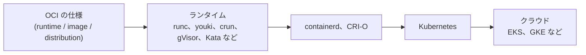

ここまでで、コンテナの中身を作って、使い方や危なさを考えられるところまで来ました。コンテナの世界は、まだまだ広がっています。最後に、ここから先に何があるのかを、簡単に紹介します。

## 学びの地図

コンテナの周りの技術を、層に分けて並べると、次のようになります。

第2章で作ったのは、この図の左のほう、ランタイムの部分です。そこから右へ進むと、たくさんのコンテナを管理する仕組みが出てきて、その先にクラウドがあります。

## youki

ランタイムの世界には、日本から生まれたプロジェクトもあります。youki は、Rust で書かれた OCI ランタイムで、`runc` と同じように、OCI の仕様に従ってコンテナを起動します。名前は、日本語の「陽気」から来ています。CNCF のプロジェクトの1つにもなっていて、ランタイムの実装を、Rust のコードとして読めます。第2章で作ったものが、実際のランタイムでは、どう書かれているのかを見てみるのも、面白いと思います。

## Kubernetes

たくさんのコンテナを、複数のマシンにまたがって管理するのが、Kubernetes です。Kubernetes は、コンテナを直接起動するのではなく、CRI (Container Runtime Interface) という標準のインターフェースを通して、`containerd` や CRI-O にお願いします。その先で、OCI ランタイム (`runc` など) が、第2章で作ったようなコンテナを起動しています。つまり、Kubernetes の中でも、最後にコンテナを動かしているのは、第2章と同じ仕組みです。AWS の EKS や Google Cloud の GKE のような、Kubernetes を管理してくれるサービスも、広く使われています。

## コミュニティ

コンテナやクラウドネイティブの技術は、コミュニティが中心になって育てています。CNCF (Cloud Native Computing Foundation) は、Kubernetes や containerd などのプロジェクトを預かっていて、Linux Foundation の下にあります。日本でも、CloudNative Days のようなカンファレンスが開かれていて、実際に使っている人や、開発している人の話を聞けます。興味があれば、覗いてみてください。

## ランタイムの自作をもっと続けたい方へ

コンテナランタイムの自作そのものに、もっと興味が湧いた方には、永見さんの [コンテナランタイム自作講座](https://coding-container-runtime.logica0419.dev/) があります。ランタイムの自作を扱った講座なので、この講義の続きとして、読んでみてください。

ここまで、お疲れさまでした。この講義が、コンテナの中身を覗いてみるきっかけになっていたら、嬉しいです。
