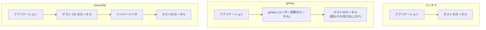

前のページで見たとおり、コンテナの隔離は、カーネルの欠陥に弱いという性質があります。そして最近は、その欠陥が、AI の力で、とても速く見つかるようになってきました。

## 脆弱性が大量に見つかる時代

Copy Fail を見つけたのは、Theori の Xint Code という、AI を使った解析システムです。Linux カーネルの暗号処理の部分を調べさせたところ、1時間ほどで見つかったそうです[^1]。9年近く見つかっていなかった欠陥が、です。AI は、脆弱性を探す側にも、攻撃する側にも使えるので、これからも、カーネルの欠陥は見つかり続けると考えておいたほうがよさそうです。実際、Copy Fail は、公開された時点で、すぐに動く攻撃コードも出回っていました。

## コンテナを信用しすぎない

コンテナの隔離は、頼りになる仕組みですが、それだけを信用してはいけない、というのが今の流れです。対策は、大きく2つあります。

1つ目は、更新を速く回すことです。ホストのカーネルの脆弱性は、修正されたカーネルに更新するしかありません。OS の更新や、クラウドの管理機能を使って、速く更新できる体制を作っておきます。コンテナの中のライブラリやベースイメージも同じで、Renovate のような、依存関係の更新を提案してくれるツールを使うと、更新のプルリクエストが自動で作られます。テストが通ったら自動でマージして、そのままデプロイまで流すようにしておけば、人手を介さずに、更新が済みます。

2つ目は、カーネルを共有しない、あるいは共有する部分を減らすことです。

### gVisor

Google が作った、コンテナ向けのサンドボックスです。コンテナの中のプロセスが呼び出すシステムコールを、ホストのカーネルに直接は渡さずに、gVisor という、ユーザー空間で動くプログラムが代わりに処理します。Linux カーネルを、ユーザー空間で作り直したようなものです。ホストのカーネルに届くシステムコールが、ごく限られたものになるので、カーネルの欠陥を突かれにくくなります。その代わり、システムコールの処理が重くなったり、動かないアプリケーションがあったりします。

### microVM

VM を、コンテナ並みに軽くしたものです。Firecracker は、AWS が作った、軽量な VM を作るためのソフトウェアで、AWS Lambda などで使われています。Kata Containers は、見た目はコンテナのまま、中身を軽量な VM で動かします。VM なので、中のプロセスはゲスト OS のカーネルで動いて、ホストのカーネルとの間には、仮想的なハードウェアという境界があります。

おおよそ、コンテナ、gVisor、microVM、VM の順に、隔離が強くなる代わりに、重くなっていきます。

## AI エージェントの実行環境の続き

第1章で、AI エージェントの実行環境として、コンテナが注目されていると紹介しました。ここでも、同じ流れが起きています。Docker Sandboxes は、通常のコンテナではなく microVM でエージェントを隔離しますし、OpenAI も、事件の後、コンテナによる隔離から、VM 型の隔離へ移行すると説明しています。エージェントが、悪意を持って隔離を破ろうとするかもしれない、という前提に立つと、カーネルを共有するコンテナだけでは、不安が残るからです。

かといって、microVM がコンテナを置き換えるわけではありません。信頼できるコードを軽く動かすなら、コンテナは今でも有力です。**どこまでを信頼できるかによって、隔離の強さを選ぶ**ことになります。

---

注釈

[^1]: [Theori の解説](https://github.com/theori-io/copy-fail-CVE-2026-31431) によると、Linux カーネルの `crypto/` の部分を、Xint Code で1時間ほどスキャンしたところ、見つかったとのことです。
