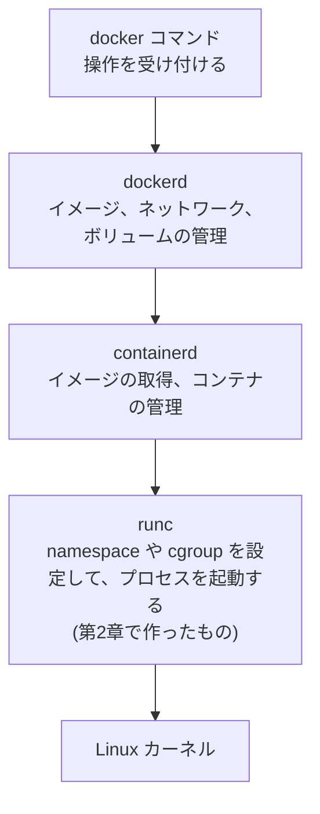

第2章では、ただのプロセスを起動するところから始めて、PID、ファイルシステム、メモリ、ユーザー、ネットワーク、権限と、隔離を1つずつ足してきました。ここからは、出来上がったものを改めて眺めながら、コンテナとは結局何なのかを考えてみます。

## コンテナの正体

コンテナは、軽量版の VM のようなものなのでしょうか。それとも、全く別のものなのでしょうか。作ってみた今なら、答えられるはずです。自作したコンテナを動かしたまま、ホストの側から `ps` で覗いてみます。

```text
$ sudo ./container run -rootfs rootfs sleep 30 &
$ ps -eo pid,ppid,comm | grep -E 'container|sleep'
     12       1 container
     19      12 sleep
```

コンテナの中の `sleep` は、ホストから見ると、`container` の子プロセスとして普通に見えています。PID は 19 です。ところがコンテナの中から見れば、このプロセスは PID 1 でした。`/proc` にある `NSpid` を見ると、2つの番号が並んでいます。

```text
$ grep -E '^(Name|NSpid)' /proc/19/status
Name:	sleep
NSpid:	19	1
```

左がホストから見た PID で、右がコンテナの中から見た PID です。つまり、コンテナの中のプロセスは、ホストから見ればただのプロセスで、PID namespace によって、中からだけ別の番号に見えていたことになります。**コンテナは、ホストのカーネルを共有して動いている、ただのプロセスです。** 別の OS を起動している VM とは、そもそも仕組みが違います。

namespace や cgroup は、このプロセスから見える範囲と使える量を絞っているだけなので、プロセスを起動して、ちょっと細工をしているだけ、と言ってもいいかもしれません。

## 特徴の理由

第1章では、コンテナには、軽い、たくさん動かせる、どこでも同じ、環境が汚れない、といった特徴があることを見ました。どうしてそうなるのかも、仕組みから説明できるようになっています。

| 特徴 | 理由 |
| --- | --- |
| 軽い、速い | OS を起動せずに、ただのプロセスを1つ起動するだけだから。第2章の `container run` も、一瞬で動き始めます |
| たくさん動かせる | ただのプロセスなので、メモリを使うのは、そのプロセスが実際に使う分だけ。OS ごとにメモリを確保する必要がない |
| どこでも同じ | イメージの正体が、rootfs (ファイルの集まり) だから。第2章で使った Alpine の `rootfs` と同じものを渡せば、どこでも同じ環境になる |
| 環境が汚れない | コンテナを消すと、namespace や cgroup は消えて、コンテナの中の書き込みも、専用の層ごと捨てられるから[^1] |

<details>
<summary>Windows や Mac でも Linux のコンテナが動くのはなぜか</summary>

コンテナは、ホストの Linux カーネルを使って動くものです。ところが、Windows や macOS のカーネルは Linux ではありません。では、どうしているのかというと、Docker Desktop や WSL2 は、裏で軽量な Linux の仮想マシンを起動していて、コンテナは、その仮想マシンの中の Linux カーネルの上で動いています。つまり、手元の Windows や Mac で動いているコンテナは、VM の上に載っていることになります。

</details>

## Docker の中のどこにあたるのか

`docker run` を実行すると、裏ではいくつかのプログラムが順番に呼ばれています。自作したランタイムは、その一番下にあたります。



`docker` コマンドは、操作を受け付けるだけです。`dockerd` というデーモン (常駐プログラム) が、イメージやネットワークといった Docker としての機能を管理して、`containerd` が、イメージの取得やコンテナの管理を担当します。そして最後に、`runc` が、渡された設定をもとに namespace や cgroup を設定して、プロセスを起動します。第2章の `container` がやっていたことは、この `runc` と同じです。

`runc` に渡される設定は、`config.json` という JSON ファイルに書かれています。第2章で、`-rootfs` や `-memory` といったオプションで渡していたものです。この `config.json` と rootfs を合わせたものを、OCI (Open Container Initiative) という標準の仕様では、bundle と呼びます。この仕様に従っていれば、`runc` 以外のランタイムも、同じように使えます。

Docker が便利なのは、イメージの管理やネットワークといった周辺の機能を、全て引き受けてくれるからです。最後にコンテナを起動する部分だけを取り出すと、第2章で作ったものになります。

---

注釈

[^1]: 第2章で作ったランタイムは、`rootfs` に直接書き込むので、書き込みがそのまま残ります。Docker は、イメージの上に書き込み用の層を重ねる overlayfs という仕組みを使っていて、コンテナを削除するときに、その層を捨てています。
