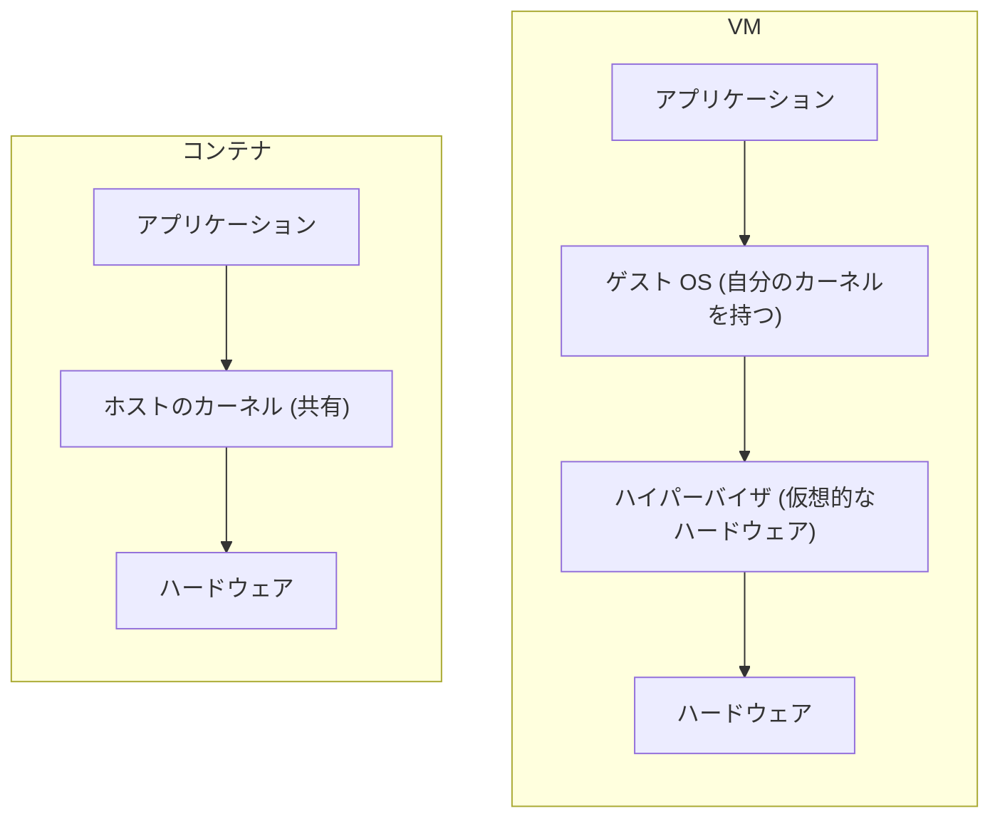

コンテナの仕組みが分かったので、その知識を、実際の判断に使ってみます。コンテナと VM のどちらを使うべきなのか、あるオプションがどれくらい危ないのか、といったことを、仕組みから見積もれるようになります。覚えることは、ほとんどありません。

## コンテナと VM の使い分け

### VM とは

VM (仮想マシン) は、簡単に言えば、マシンの上で別のマシンを丸ごと動かす仕組みです。ハイパーバイザというソフトウェアが、仮想的なハードウェア (CPU、メモリ、ディスクなど) を作って、その上でゲスト OS を最初から起動します。ゲスト OS は、それぞれが自分専用のカーネルを持っています。

一方でコンテナは、ここまで見てきたとおり、ホストのカーネルをそのまま共有します。



この違いが、そのまま軽さの違いになります。VM は OS を丸ごと起動するので、使えるようになるまでに数十秒から1分以上かかって、起動しただけで数百 MB から数 GB のメモリを使います。コンテナは、ただのプロセスを起動するだけなので、1 秒前後で、メモリも数 MB 程度で済みます (どちらも目安です)。

### 境界の違い

もう1つ大きな違いが、隔離の境界です。コンテナの隔離は、ホストのカーネルの機能 (namespace、cgroup、capability、seccomp など) でできています。つまり、隔離の境界のすぐ向こう側に、ホストのカーネルがいます。一方で VM は、ゲスト OS とホストの間に、仮想的なハードウェアという、ずっと狭い境界があります。ゲスト OS のカーネルが乗っ取られたとしても、ホストのカーネルには、そのままでは届きません。

つまり、コンテナの軽さには代償があって、**その代償が、ホストのカーネルを共有していることです。**

### 場面ごとの向き不向き

どちらが向いているかは、動かすものを、どこまで信用できるかによって変わります。

| 場面 | 向いているもの | 理由 |
| --- | --- | --- |
| 自分の Web アプリを、複数動かす | コンテナ | 自分で書いたコードなので、信用できる。軽くて、たくさん動かせる |
| 他人が書いたコードを実行する | VM、または VM に近いもの | 悪意のあるコードが、カーネルの欠陥を突いてくるかもしれない |
| AI エージェントに実行させる | 想定する危険による | 単純なミスを閉じ込めたいだけならコンテナで足りる。悪意のある動作まで想定するなら VM 型 |
| 別のカーネルが必要 | VM | コンテナはホストのカーネルを使うので、Linux 上で Windows のアプリや、別バージョンのカーネルは動かせない |

最近は、この中間を狙うものも出てきています。VM をコンテナ並みに軽くした microVM や、コンテナのカーネルへの依存を減らす gVisor などです。これらは、この章の後半で改めて触れます。

## 設定から読み取るリスク

もう1つ、作ってみたおかげで見積もれるようになったのが、設定の危なさです。例えば `docker run` に付けるオプションの中には、危険だと言われているものがあります。そのオプションの名前と危険性を、丸ごと覚える必要はありません。何をするオプションなのかが仕組みから分かれば、どれくらい危ないのかも、だいたい想像がつきます。ここでは、第2章のどのステップの逆にあたるのかを、手がかりに考えてみます。

### `--privileged`

`--privileged` を付けると、コンテナに、ほぼ全ての capability が与えられて、seccomp などの制限も外れて、ホストのデバイスにもアクセスできるようになります。つまり、ステップ 6 で絞ったものを全て元に戻した状態です。マウントも自由にできるので、ホストのディスクのデバイスをコンテナの中にマウントして、ホストのファイルを丸ごと読み書きする、といったこともできてしまいます。ここまでくると、隔離の意味は、ほとんど残っていません。

### `--pid=host`

コンテナに、ホストの PID namespace をそのまま使わせるオプションです。ステップ 1 の逆で、ステップ 0 の状態に戻ります。ホストのプロセスが全て見えて、PID を指定して `kill` することもできてしまいます。

### `--network=host`

コンテナが、ホストと同じネットワークを使うオプションで、ステップ 5 の逆です。第2章で `-net` を付けずに実行したときと同じで、ホストのネットワークインターフェースがそのまま見えます。

```text
$ sudo ./container run -rootfs rootfs ip -o -4 addr | awk '{print $2, $4}'
lo 127.0.0.1/8
eth0 172.17.0.3/16
$ sudo ./container run -rootfs rootfs -net ip -o -4 addr | awk '{print $2, $4}'
lo 127.0.0.1/8
eth0 10.0.0.2/24
```

1つ目では、ホストの `eth0` がそのまま見えています。ホストが待ち受けているポートにも、つながってしまいます (アドレスは環境によって変わります)。

### `-v /var/run/docker.sock:/var/run/docker.sock`

最後は、少し毛色が違います。これは、ホストの Docker デーモンと話すための窓口 (ソケット) を、コンテナの中に渡すオプションです。コンテナの中から、別のコンテナを `--privileged` で起動できてしまうので、実質的に、ホストの root 権限を渡したのと同じことになります。

ここまでの対応を、表にまとめておきます。

| オプション | 第2章のどのステップの逆か | 起きること |
| --- | --- | --- |
| `--privileged` | ステップ 6 (capability と seccomp) | 隔離の仕組みがほとんど外れて、ホストのデバイスにも触れる |
| `--pid=host` | ステップ 1 (PID namespace) | ホストのプロセスが見えて、`kill` もできる |
| `--network=host` | ステップ 5 (network namespace) | ホストのネットワークをそのまま使える |

初めて見るオプションに出会ったときも、どの隔離を外すものなのかを考えれば、危なさの見当がつきます。
