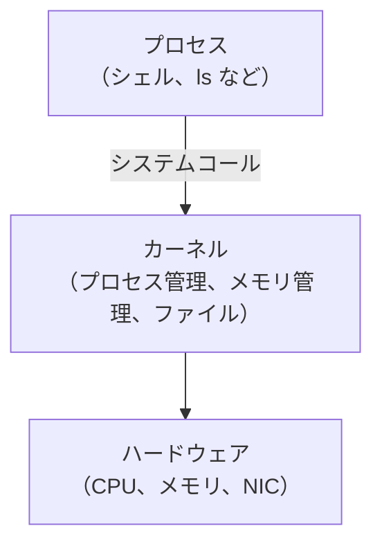
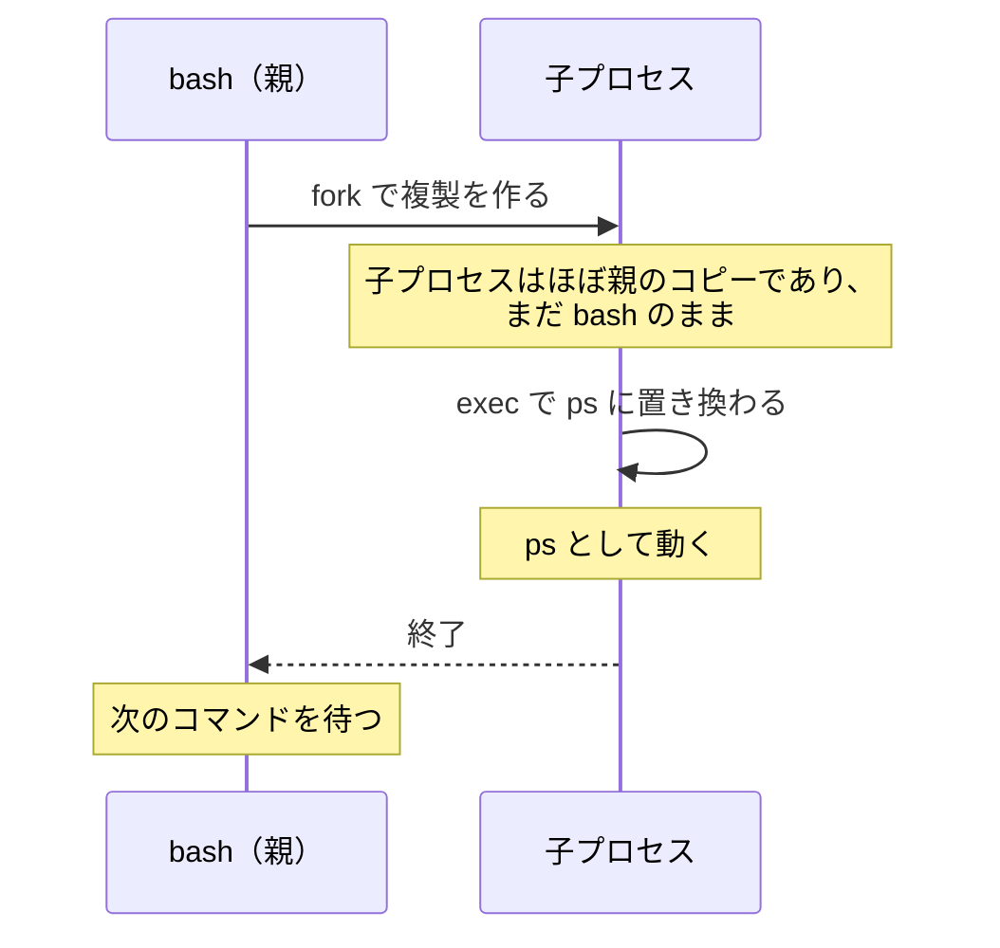

応募課題の問いでは、Linux コンテナの基礎となるシステムプログラムに関する小問題を設けていました。

> Linux において、プログラムを実行するときに「プロセス」がどのように作られるかを調べて、自分の言葉で説明してください。
>
> その際、可能であれば fork、exec、clone、system call という言葉のうち、分かるものを使って説明してください。すべてを正確に説明できなくても構いませんが、どこまで理解したか、どこがまだ分からないかも書いてください。

この問いの出題は、必要な知識の事前学習という意味も兼ねていました。ここでは、出題の内容に対する解説と、システムプログラムに関する基礎知識の説明を行います。

### プロセスとは

プログラムは、ディスクに置かれた実行ファイルです。それに対してプロセスは、そのプログラムが実行されている状態で、OS が一つの単位として管理しています。プロセスには一意な ID が振られていて、これを PID (Process ID) と呼びます。プロセスには、PID、専用のメモリ空間、開いているファイル、実行ユーザー、親プロセスなどの情報が実行の状態として紐づいています。つまり、同じプログラムでも2回実行すれば、プロセスは2つできることになります。

```sh
ps -o pid,ppid,comm
```

出力は次のようになります（数字は環境によって変わります）。

```text
    PID    PPID COMMAND
      1       0 bash
      7       1 ps
```

`PPID` が親プロセスの ID です (Parent Process ID)。ここでは、`ps` の親が PID 1 の `bash` になっています。つまり、`ps` というプロセスは、`bash` によって作られたということです。プロセスは必ず、いずれかのプロセスから作られます。

### システムコールとは

ターミナルで `ls` を実行すると、ファイルの一覧が表示されます。このとき `ls` は、ディスクからディレクトリの情報を読み取り、画面に文字を出力しています。ところが、`ls` というプログラムには、ディスクや画面を直接操作する処理が含まれているわけではありません。この部分は、カーネルに処理を依頼しています。どうしてこのような分け方をするのでしょうか。

コンピュータでは、多くのプロセスが同時に動いています。もし全てのプロセスがディスクやメモリを自由に触れたら、あるプロセスが別のプロセスのデータを書き換えたり、盗み見たりできてしまいます。一つのプログラムの不具合が、システム全体を壊すことにもなりかねません。

そこで、CPU、メモリ、ディスク、ネットワークといったハードウェアの管理は、OS の中核であるカーネルが一手に引き受けています。普通のプロセスは、ハードウェアに触れたくなったら、カーネルに「このファイルを開いてください」とお願いします。このカーネルへの処理要求がシステムコール（syscall）です。`open`、`read`、`write`、`fork` などがその例です。



プロセスはカーネルに処理を依頼しないと、ファイルを読んだりメモリを確保したりなどの特別な操作は何もできません。逆に言えば、プロセスが何ができるか、どの資源 (= CPU やメモリ) をどれだけ使えるかは、カーネルが決めています。ということは、**カーネルに特定のプロセスの資源や権限を制限するように依頼する**ようなシステムコールがあったら、そのプロセスの権限を限りなく落とせるのではないでしょうか？…実は、ざっくり言えばこれがコンテナの正体です。

コンテナは、この「特定のプロセスの権限を絞ったり触れる範囲を制限する」システムコール[^1]を利用して、プロセスから見える世界を分けたり、使える資源を制限したりしています。この講義では、そのためのシステムコールを順番に呼び出して、コンテナを組み立てていきます。

...と、話が脱線しすぎたので戻します。

### プロセスはどう作られるのか

先ほどの `ps` の例では、`bash` が `ps` のプロセスを作っていました。`bash` のようなシェルは、ターミナルでコマンドを実行するたびに、新しいプロセスを作っています。このように「新しいプロセスを作る時」に汎用的に使われるのが、`fork` と `exec` という2つのシステムコールです。

1. `fork`：呼び出したプロセスの複製（子プロセス）を作る。作った側が親になる
2. `exec`：今のプロセスの中身を、別のプログラムに置き換える

上記の説明ではまだ分からないと思うので、図で解説します。



`fork` の直後の子プロセスは、親と同じ `bash` です。そこで子が `exec` を呼ぶと、中身が `ps` に置き換わります。`ps` が終了すると、待っていた親の `bash` が次の処理をはじめます。

もう一つ似たようなものに、`clone` というシステムコールもあります。`fork` と同じように子プロセスを作りますが、`clone` を呼び出すときに同時にフラグを指定することで、親子のプロセスでどのようなリソースを共有し、どのようなリソースを分けるかを指定することができます。この仕組みが、コンテナの「隔離」にも使われることになります。...なんとなくコンテナのイメージが付いてきたでしょうか。

### 実際に呼び出される syscall を見てみる

`strace` を使うと、プロセスが呼び出した syscall を見られます。[開発環境](../environment/) で試してみてください。`strace` が入っていなければ、`sudo apt-get update && sudo apt-get install -y strace` でインストールできます。

下記は、`bash` を起動して `ls` コマンドを実行するものです。

```sh
strace -f -e trace=execve,clone,clone3,wait4 bash -c 'ls > /dev/null'
```

出力は次のようになります（数字は環境によって変わります）。

```text
execve("/usr/bin/bash", ["bash", "-c", "ls > /dev/null"], ...) = 0
clone(child_stack=NULL, flags=CLONE_CHILD_CLEARTID|CLONE_CHILD_SETTID|SIGCHLD, ...) = 44
[pid    43] wait4(-1 <unfinished ...>
[pid    44] execve("/usr/bin/ls", ["ls"], ...) = 0
[pid    44] +++ exited with 0 +++
```

`bash` が起動し、`clone` (=ほとんど `fork` と一緒です) で子プロセスを作っています。子プロセスには、上記では PID 44 が割り振られました。次に、その子が `execve` (=ほとんど `exec` と一緒です) で `ls` に置き換わり、親は `wait4` で子の終了を待っています。先ほど説明した `fork` と `exec` の流れそのままになっていることが確認できます。

---

注釈

[^1]: 実際にはこのようなシステムコールは用途に応じて複数種類あります。詳しくは講義で解説します。
